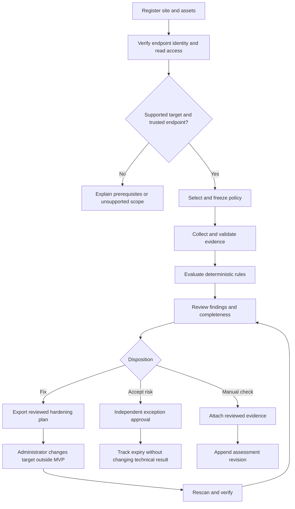
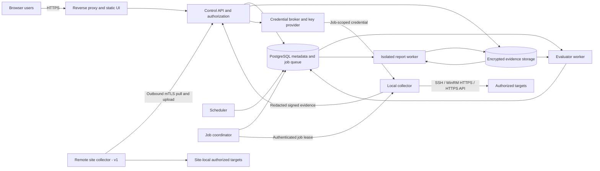
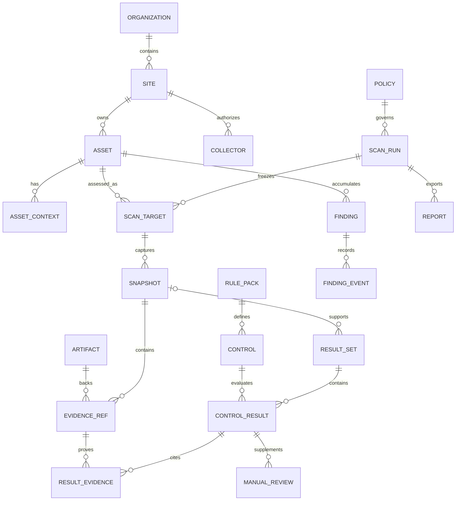
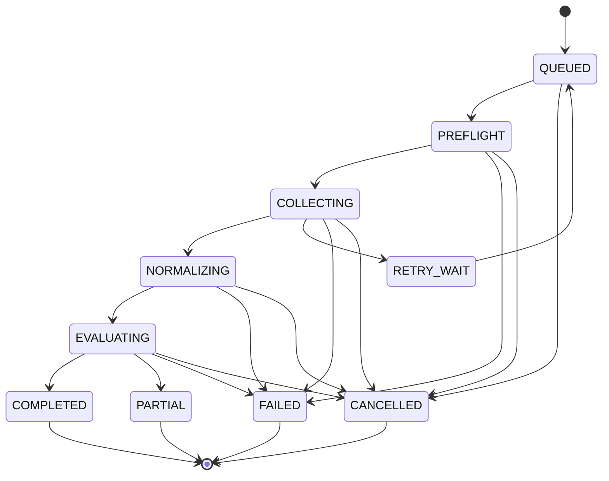
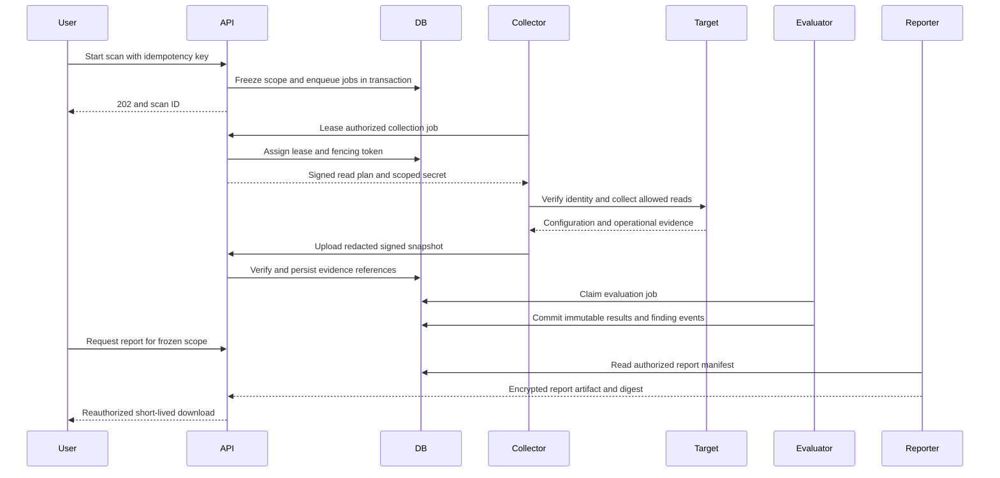

# BaselineGuard — Automated CIS Benchmark Compliance and Hardening Auditor

**Document type:** Product Requirements Document and implementation specification  
**Version:** 1.0  
**Prepared:** 29 October 2026  
**Status:** Proposed build baseline; no product implementation is included in this deliverable  
**Deployment model:** Self-hosted, offline-capable, single organization per installation initially  
**Software license decision:** Apache-2.0 for original application code; benchmark content and dependencies retain their own licenses  
**Hard constraints:** No AI/ML, no paid third-party API dependency, deterministic evaluation, GUI and exportable reports

**Navigation:** [Scope](#4-scope-assumptions-and-release-boundaries) · [Requirements](#5-functional-requirements-and-acceptance-criteria) · [Architecture](#7-system-architecture-and-technology-decisions) · [Collectors](#8-collection-and-normalization-contracts) · [Rules](#9-rule-engine-and-baseline-lifecycle) · [Data model](#12-database-and-storage-specification) · [APIs](#14-api-specification) · [Security](#16-security-privacy-and-threat-model) · [Testing](#18-testing-and-verification-plan) · [Roadmap](#21-phased-implementation-roadmap)

## 1. Executive decision

Build **BaselineGuard**, an open-source platform that collects configuration evidence from authorized operating systems and network infrastructure, evaluates versioned policies, and explains each result with its expected value, observed value, evidence, and a reviewed remediation procedure. Its primary promise is **a defensible answer with visible limits**, rather than a high compliance percentage produced from incomplete scans.

The platform must distinguish configuration that is compliant, noncompliant, inapplicable, unknown, unavailable, or awaiting human assessment. It must also distinguish a CIS-derived assessment from an independently authored organizational hardening baseline. A connection failure, unrecognized syntax, or missing permission must never become a pass.

The initial product provides collection, audit, prioritization, evidence review, exceptions, reporting, and downloadable hardening plans. It does **not** execute configuration changes on devices. A later, separately gated capability may execute a small allowlist of tested remediations with approval and rollback controls. This interpretation fulfills actionable hardening requirements without making production modification a prerequisite for useful auditing.

### 1.1 Non-negotiable product rules

1. Same immutable evidence, rule pack, policy revision, engine version, and evaluation context produce identical canonical result payloads.
2. No AI model, learned classifier, LLM, embedding service, or paid external API participates in collection, evaluation, explanation, prioritization, or reporting.
3. Audit traffic uses authenticated, encrypted management channels; no Telnet collection, blind SSH host-key acceptance, or disabled TLS certificate validation.
4. The scanner has no generic remote shell or configuration-write endpoint exposed through its GUI/API. Privileged readers use narrowly scoped, reviewed adapters.
5. An asset is supported only for the exact tested product/version/role/capability combination declared in its compatibility manifest.
6. Reports reveal sample scope, evidence age, incomplete checks, baseline deviations, exclusions, and manual decisions.
7. CIS names, mappings, text, and redistributed content require appropriate rights. Open-source application licensing does not grant those rights.
8. All requested target families remain in the delivery scope; phasing is explicit and the MVP must not be advertised as full coverage.

## 2. Problem, users, and product opportunity

### 2.1 Real-world problems beyond the brief

| Problem | Operational consequence | Required response |
|---|---|---|
| Mixed Windows roles, Linux distributions, firewall firmware, and switch capabilities | A generic script applies the wrong rule or assumes the wrong default | Fingerprint product, version, role, edition, context, and capabilities before selecting rules |
| Partial permissions or disconnected endpoints | Reports appear green because checks were silently skipped | Explicit collection diagnostics, missing-evidence results, and assessment completeness |
| Running, startup, candidate, and centrally managed policies differ | An auditor evaluates a configuration that is not actually enforced | Preserve configuration plane, source revision, installation state, and context |
| Firewall rule intent is not available in raw text | Broad but legitimate rules become noise; shadowed rules are missed | Deterministic, bounded semantic analysis plus owner-provided intent |
| Exceptions persist indefinitely | Accepted risk disappears from dashboards | Expiring approvals, compensating controls, ownership, and unchanged technical findings |
| Benchmark revisions alter tests and thresholds | Trend lines mix real drift with changing standards | Immutable policy versions and explicit comparability indicators |
| Configuration exports contain secrets and topology | The compliance platform becomes a high-value exfiltration target | Evidence minimization, encryption, redaction, role separation, and access logging |
| Small IT teams cannot maintain many agents or commercial services | Adoption costs exceed tool benefits | Agentless default, simple local deployment, optional outbound-only site collectors |
| Hardening commands can break remote access, applications, or HA | Teams avoid remediation or apply unsafe mass changes | Preconditions, impact, validation, rollback, and authority-aware guidance |
| Audits are snapshots, but dashboards imply continuous assurance | Stale results are mistaken for present-day security | Freshness badges, scheduled rescans, drift events, and visible observation timestamps |

### 2.2 Personas and jobs to be done

| Persona | Job | Primary workflow | Success measure |
|---|---|---|---|
| Security analyst | Identify credible high-risk deviations | Filter findings, inspect evidence, assign owners | Less than 10 minutes from a completed scan to a prioritized worklist |
| Windows/Linux administrator | Fix configuration without disrupting workloads | Review expected/actual, authority, command plan, and rescan | Fewer re-opened findings and fewer incorrect recommendations |
| Network/security engineer | Audit device policy with vendor semantics | Inspect context, ACL attachment, objects, defaults, and exposure witness | Every supported network finding traceable to configuration evidence |
| Compliance auditor | Reproduce and substantiate an assessment | Read frozen reports, scope, exceptions, and signed manifests | No spreadsheet reconciliation for the pilot audit package |
| Platform operator | Run the service safely | Configure identity, collectors, backups, trust, and retention | Restore within the recovery target and identify failing collectors promptly |
| Risk approver | Accept justified temporary deviations | Review reason, scope, expiry, and compensating controls | No accepted exception without an owner and expiry |

### 2.3 Vision and positioning

Provide an accessible, evidence-centered compliance workbench for organizations managing approximately 100–10,000 assets, including disconnected sites. Compete on explainability, deployment simplicity, accurate network interpretation, maintainable policies, and reliable exports. Do not attempt to replace a SIEM, vulnerability scanner, configuration manager, CMDB, or commercial firewall optimization suite.

Differentiating capabilities are hypotheses to validate in pilots, not claims that competitors lack equivalent features:

- **Evidence replay:** Re-evaluate an existing snapshot with its original inputs; compare against a proposed policy without recontacting devices.
- **Honest scorecard:** Show compliance and completeness together, including unreachable inventory and unsupported recommendations.
- **Intent-aware switch checks:** Evaluate unused ports against declared port purpose; do not infer abandonment from a temporarily down link.
- **Explainable network findings:** Provide the rule IDs, expanded objects, direction, and example traffic tuple supporting a result.
- **Policy change preview:** Show which prior findings would change because of a threshold or benchmark revision.
- **Offline evidence package:** Share a manifest, results, redacted evidence, and verification instructions without cloud access.
- **Change-authority guidance:** Identify when GPO, Panorama, a Check Point management server, or another controller will overwrite a local fix.

## 3. Research findings and decision rationale

Research below was reviewed on 29 October 2026. Documentation describes products, not a comparative hands-on benchmark. Prices, benchmark revisions, supported syntax, and firmware compatibility must be rechecked before each release.

### 3.1 Existing solutions

| Solution | Verified capabilities | Decision for BaselineGuard |
|---|---|---|
| Wazuh SCA | Endpoint configuration checks use customizable YAML policies; checks include files, processes, and registry data. [Wazuh SCA documentation](https://documentation.wazuh.com/current/user-manual/capabilities/sec-config-assessment/index.html) | Learn from policy usability and endpoint evidence. Build a narrower audit workbench with an explicit network normalization model, instead of bundling a full security-monitoring stack. Reuse content only after per-file license review. |
| OpenSCAP and ComplianceAsCode | SCAP provides machine-readable security assessment; ComplianceAsCode publishes Linux-oriented content and several output formats. [OpenSCAP security compliance](https://www.open-scap.org/features/security-compliance/), [ComplianceAsCode repository](https://github.com/ComplianceAsCode/content) | Add an optional SCAP result/content adapter later. The MVP uses one typed rule model across OS and network devices. Do not implement XCCDF/OVAL interpretation from scratch. |
| CIS-CAT Lite / Pro | Lite covers selected technologies; Pro assessment is offered through SecureSuite membership. [CIS-CAT Pro overview](https://www.cisecurity.org/cybersecurity-tools/cis-cat-pro) | Use as an optional comparison oracle where access permits. Never depend on it at runtime or redistribute its content by assumption. |
| Tenable Nessus | Credentialed configuration auditing supports custom audit policies; the vendor distinguishes compliance auditing from vulnerability detection. [Nessus compliance documentation](https://docs.tenable.com/nessus/10_9/Content/Compliance.htm) | Treat as a mature commercial comparison, not proof that the market has no alternatives. Focus on local ownership, reviewable rules, and no paid API dependency. |
| Batfish | Open-source network configuration analysis with many supported vendor families; feature coverage still depends on syntax and platform. [Batfish repository](https://github.com/batfish/batfish) | Evaluate for advanced path and differential analysis. Keep it outside the MVP critical path and test every claimed feature independently. |

### 3.2 CIS content, naming, and licensing gate

CIS lists free benchmark PDFs for non-commercial use and publishes terms governing non-member products; those terms must not be equated with unrestricted commercial redistribution or derivative rights. [CIS non-member terms](https://www.cisecurity.org/terms-of-use-for-non-member-cis-products), [CIS terms index](https://www.cisecurity.org/terms-and-conditions-table-of-contents)

**Product decisions:**

- Ship original, independently authored organizational rules with their provenance and license. Do not copy benchmark prose into the public repository without established permission.
- Support importing rights-cleared benchmark packs for authorized organizational use. Import does not establish legal entitlement; capture the publisher, license reference, allowed use, and distribution restrictions.
- Make pack distribution approval a release gate with a designated legal/content owner. The default software must remain useful without a paid content feed.
- Label unmapped rules “organizational hardening.” Use “CIS-mapped assessment” only for reviewed, exact benchmark mappings with authorized usage. Never claim CIS certification or endorsement without the corresponding approval.
- Separate the engine license, rule-pack license, third-party notices, and report redistribution permissions.

These are implementation safeguards, not a legal determination. If rights to ship a complete CIS pack cannot be established, publish the engine and original controls, clearly declare the CIS-content gap, and do not call the CIS-content release gate complete.

### 3.3 Platform and technology evidence

- CIS maintains distinct network-device families; Cisco IOS, IOS XE, ASA, and FTD must not be treated as one benchmark. Sophos currently has its own catalog entries. [CIS network benchmark catalog](https://resources.cisecurity.org/benchmarks), [Cisco benchmarks](https://www.cisecurity.org/benchmark/cisco), [Sophos benchmarks](https://www.cisecurity.org/benchmark/Sophos)
- PowerShell remoting requires deliberate authentication and server-identity validation. JEA supports constrained functions and parameters. BaselineGuard chooses validated WinRM HTTPS and a dedicated reader interface. [Microsoft WinRM security](https://learn.microsoft.com/en-us/powershell/scripting/learn/remoting/winrmsecurity), [JEA role capabilities](https://learn.microsoft.com/en-us/powershell/scripting/security/remoting/jea/role-capabilities)
- PAN-OS XML API distinguishes active configuration (`action=show`) from candidate configuration (`action=get`). The adapter must label both accurately. [PAN-OS configuration API](https://docs.paloaltonetworks.com/ngfw/api/pan-os-xml-api-request-types-and-actions/configuration-api)
- Fortinet documents API administrator profiles and trusted hosts; Sophos documents explicitly enabling its local API for trusted IP addresses. Use device-local management, not a paid cloud API. [Fortinet API administrator](https://docs.fortinet.com/document/fortigate/7.0.8/administration-guide/399023), [Sophos API configuration](https://docs.sophos.com/nsg/sophos-firewall/21.5/help/en-us/webhelp/onlinehelp/AdministratorHelp/BackupAndFirmware/API/APIConfiguration/index.html)
- Check Point exposes separate management-policy and Gaia operating-system APIs. These are separate evidence sources. [Check Point API reference](https://sc1.checkpoint.com/documents/latest/api_reference/index.html)
- Netmiko offers multi-vendor CLI transport, but its own support matrix distinguishes testing levels. A library driver is not a product compatibility guarantee. [Netmiko platform matrix](https://github.com/ktbyers/netmiko/blob/develop/PLATFORMS.md)
- Ubuntu 20.04 entered extended maintenance in May 2025; Windows Server 2019 extended support ends in January 2029. Continue auditing requested legacy targets while displaying lifecycle status separately from configuration compliance. [Ubuntu announcement](https://lists.ubuntu.com/archives/ubuntu-announce/2025-April/000310.html), [Microsoft lifecycle](https://learn.microsoft.com/lifecycle/products/windows-server-2019)

## 4. Scope, assumptions, and release boundaries

### 4.1 Assumptions

- The operator owns or is authorized to audit each target and can supply a reachable management endpoint, approved credentials, and maintenance constraints.
- Production targets may require privileged reads. “Read-only audit” means no intentional configuration changes; temporary files, authenticated sessions, and audit logs may still be created. Adapters declare these side effects.
- Target operating systems, virtual appliances, lab images, and enterprise support may have their own licensing costs. “No paid API” does not mean hardware, engineering, hosting, or vendor licenses are free.
- Initial hosting is a Linux server; Windows targets do not require the control plane to run on Windows. The GUI works in a browser.
- One organization per installation is the MVP security boundary. Site/group restrictions apply within it. Database organization keys are retained for isolation and future use; multi-customer SaaS is not an MVP claim.
- A three-person student team should build the demonstration slice only. The production roadmap assumes five full-time engineers, one QA/SRE engineer, and part-time Windows/network/security/content specialists.

### 4.2 Scope levels

| Level | Included | Explicitly excluded from this level |
|---|---|---|
| Demonstration, weeks 1–4 | One live Ubuntu 22.04 target, one live Cisco IOS XE router, fixture-based Windows/Fortinet examples, 20 original rules, basic GUI and JSON/HTML export | Production readiness, full benchmarks, fixture devices labeled as live |
| MVP/pilot, through week 12 | Platforms in the MVP rows below; agentless scans; signed packs; RBAC/MFA; policy customization; scoring; evidence; exceptions; schedules; PDF/HTML/CSV/JSON; reproducibility; backup and restore | All-vendor completeness, HA control plane, push agents, automatic configuration changes |
| Scope-complete v1, through week 24 | Every requested family below; full selected recommendation inventories with transparent automation coverage; remote site collectors; SSO; scale and recovery validation; provenance-aware comparisons | Universal firmware support or universal automated assessment |
| Advanced, weeks 25–32+ | Optional Batfish integration, deeper ACL semantics, change simulations, SCAP integration, tightly governed remediation execution | AI/ML and mandatory paid API services remain excluded |

### 4.3 Target compatibility plan

Version families below are **engineering lab targets**, not already certified compatibility or claims that they are the latest supported vendor release. Phase 0 freezes exact image/build, patch, benchmark revision, role, and feature fixtures in `compatibility.yaml`. A failed lifecycle or entitlement review replaces the lab image with an appropriate supported patch and records the decision; it does not silently broaden advertised support.

| Platform / role | Collection path | MVP | Scope-complete v1 |
|---|---|---|---|
| Ubuntu 22.04 LTS Server and Desktop, x86-64 | SSH, fixed reader scripts, effective service/kernel settings | Both roles; 40 automated logical controls per applicable profile | Selected L1 profile inventory, extended user/session checks |
| Windows 11 Enterprise 24H2, standalone and domain-joined | WinRM HTTPS, PowerShell reader endpoint | Both modes; 40 automated logical controls per applicable profile | Additional validated supported Enterprise builds through separate manifests |
| Windows Server 2019 Standard/Datacenter, standalone/member server | Same Windows transport; role-aware evidence | Standalone/member; 40 automated logical controls per applicable profile | Domain controller profile and effective domain-policy evidence |
| Fortinet FortiGate / FortiOS 7.4.x | Local HTTPS API; vetted SSH show fallback | Single appliance, root VDOM; 30 automated controls | Multi-VDOM, HA member distinction, inherited/default settings |
| Cisco IOS XE 17.x router; initial lab 17.12 train | SSH show commands | Router role; 30 automated controls | Additional patch trains and explicit VRF/context support |
| Cisco Catalyst IOS XE 17.x managed switch; initial lab 17.12 train | SSH show commands and interface/VLAN state | Switch role; 30 automated controls | Stack/member identities and expanded L2 checks |
| Ubuntu 20.04 LTS Server and Desktop | Linux adapter with separate defaults and version guards | No | Required, with maintenance status shown |
| RHEL 8 and RHEL 9, Server and Workstation roles | SSH, distribution-specific readers | No | Both majors required; authselect, SELinux, firewalld/nftables distinctions |
| Cisco ASA 9.x; initial lab 9.18 train | SSH read commands | No | Required Cisco firewall representative; ASA-specific ACL/NAT/default semantics |
| Check Point Gaia R81.20 gateways plus matching management server | Gaia read evidence plus Management API | No | Required; package/layer/context and installed-policy provenance |
| Sophos Firewall SFOS 21.x; initial lab 21.5 | Local XML API Get operations; supported export/CLI readers | No | Required; API entity coverage declared per version |
| Palo Alto PAN-OS 11.x; initial lab 11.1 | XML API active configuration and operational read commands | No | Required; vsys, shared objects, effective rule ordering, Panorama provenance |

MVP counts are minimum independently useful control implementations, not a claim of full CIS coverage. Platform variants must pass their own fixtures even where they reuse rules. The Linux “or” in the brief is resolved expansively: ship Ubuntu first, then cover both Ubuntu versions and both RHEL majors by v1. Cisco firewall scope means ASA initially; FTD, IOS XR, NX-OS, Sophos UTM, and Windows Home are separately scoped future adapters.

**v1 coverage gate:** For each selected, authorized benchmark/profile, catalog 100% of its recommendations as automated, manual, unsupported, or proven not applicable. Implement at least 80% of recommendations classified as automatable in that selected profile; publish numerator, denominator, and exclusions. This is a coverage target, not a declaration that unimplemented recommendations pass. If a family cannot meet the gate, label it beta and do not claim scope-complete v1.

### 4.4 Non-goals

- Exploitation, malware detection, password cracking, packet interception, external attack-surface discovery, or penetration testing.
- Scanning arbitrary Internet ranges or automatically discovering credentials.
- Proving regulatory certification, guaranteeing absence of compromise, or equating a configuration score with overall security.
- Automatic PDF-to-rule extraction, runtime execution of uploaded Python/Bash/PowerShell, or heuristic inference presented as facts.
- A generic policy editor that permits unbounded code execution.
- Endpoint patch deployment, firmware upgrades, or full configuration backup management.

## 5. Functional requirements and acceptance criteria

Priority: **M** = MVP must-have; **V1** = scope-complete release; **A** = advanced. Every acceptance criterion becomes a traceable test or release checklist item.

| ID | Priority | Requirement | Acceptance criteria |
|---|---|---|---|
| FR-01 | M | Inventory and ownership | Add/edit/archive assets individually or via validated CSV; retain UUID, category, site, owner, tags, endpoint, intended role and criticality. Duplicate keys and invalid endpoints return row-specific errors; preview precedes import. |
| FR-02 | M | Scope and trust preflight | Show resolved address, allowed site, expected host key/certificate, adapter, required read privileges and policy. Unknown trust prevents collection until an administrator verifies it out of band. |
| FR-03 | M | Live collection | Every MVP platform has lab-proven authenticated live collection, pagination/output completeness checks, bounded execution, and permission diagnostics. |
| FR-04 | M | Offline input | Accept a declared supported config or signed snapshot bundle. Record uploader, source, capture time, hash, and attestation. Unverified timestamps/identity remain unverified; uploaded data cannot masquerade as freshly collected evidence. |
| FR-05 | M | Deterministic engine | Every declared rule has pass/fail/missing-evidence fixtures; 100 repeated replays yield the same semantic digest. No command executes from rule YAML. |
| FR-06 | M | Custom baseline editor | Change only typed parameters, selected controls, severity overrides, and selectors. Preview affected results; publish immutable revisions with author, reviewer, reason and diff. |
| FR-07 | M | Safe scheduling | On-demand/daily/weekly schedules honor site windows, IANA timezone, concurrency and blackout dates. Repeated scheduler ticks do not create duplicate occurrence runs. |
| FR-08 | M | Audit progress | GUI shows per-asset queued/running/partial/completed/failed/cancelled state, stage, timestamps, and actionable errors. Cancellation stops new commands and preserves collected evidence. |
| FR-09 | M | Dashboard | Category/severity/site/owner filters; compliance and completeness side by side; fresh, stale, never-scanned and unreachable asset counts; no green “100%” when denominator is zero. |
| FR-10 | M | Finding detail | Show source benchmark expectation where permitted, organization expectation, typed actual value, status, reason, severity source, evidence pointer, rule version, source context, and remediation plan. |
| FR-11 | M | Findings lifecycle | Assign owner/due date/comment; only a valid newer assessment resolves a technical failure. An exception or user clicking “done” cannot resolve it. |
| FR-12 | M | Exceptions and manual reviews | Require bounded scope, justification, compensating controls, reviewer, expiry, and evidence. Approval cannot be self-granted; expiry automatically restores actionability. |
| FR-13 | M | Reports | One action creates PDF, self-contained HTML, CSV, or JSON from a frozen authorized scope. Counts reconcile; truncation is disclosed; commands preserve line breaks. |
| FR-14 | M | RBAC, MFA and access audit | Enforce role/site restrictions server-side, including exports and evidence. Local interactive accounts require TOTP enrollment; secrets cannot be read back. |
| FR-15 | M | Evidence integrity and replay | Store immutable input digests and signed manifest. Verify a downloaded bundle locally; modified bytes fail verification. |
| FR-16 | M | Drift and recheck | Compare two compatible snapshots; show changed values and evidence age. Different policies appear as policy changes, not unexplained device drift. |
| FR-17 | V1 | All requested families | Every v1 matrix row passes its live adapter contract and content-coverage gate. |
| FR-18 | V1 | Distributed collection | Enrolled site collectors pull jobs over mTLS, enforce local target allowlists, and cannot access another site's tasks or credentials. |
| FR-19 | V1 | Enterprise identity/integration | OIDC SSO, scoped API tokens, signed webhooks, and outbound exports work without a paid service. Group mapping cannot elevate beyond explicit administrator configuration. |
| FR-20 | A | Network impact simulation | An optional deterministic analyzer produces scoped witnesses/counterexamples and declares unsupported features. It never substitutes an approximate result for exact compliance. |
| FR-21 | A | Controlled remediation | Separate credentials, reviewed templates, two-person approval, stale-state checks, canaries, verification and rollback satisfy section 13 before enabling writes. |

## 6. User workflows and GUI specification

### 6.1 First installation and first audit

1. Operator starts the installation with a one-time bootstrap token delivered through a local operator channel; no default password or open registration.
2. Creates the organization, administrator identity, MFA, local CA/trust configuration, encryption-key backup, timezone, and retention settings.
3. Registers a site and its allowed management CIDRs, DNS suffixes, protocols, and scan windows.
4. Imports assets; preview validates duplicates, site boundaries, role declarations, and baseline compatibility.
5. Adds an encrypted credential and binds it to allowed assets. A secret test returns capability diagnostics without revealing the secret.
6. Verifies target trust fingerprints out of band; preflight detects product/build/context and displays required permissions.
7. Selects a published policy revision. GUI displays inventory coverage, implementation coverage, excluded recommendations and customization differences.
8. Starts the scan. The system freezes target IDs, policy revision, context facts, and adapter/engine versions.
9. Reviews the result with freshness and completeness, assigns failures, downloads remediation plans, and exports the audit package.



### 6.2 Investigation and remediation workflow

Open a finding from the dashboard. Display the exact resource (interface, registry key, firewall rule UUID, service, or policy context), expected/actual values, configuration source, and result trace. Analyst checks context and owner intent. Administrator downloads the approved procedure, assesses maintenance requirements, changes the target through the authoritative configuration system, and triggers a rescan. A later compatible pass closes the finding; missing evidence changes its freshness/verification state but does not close it.

### 6.3 Policy author workflow

Clone a published policy into a draft, edit schema-controlled parameters, and compare the proposed policy against selected historical snapshots. The preview shows expected coverage changes, stronger/weaker thresholds, changed findings, newly excluded controls, and impacts on comparability. A different policy approver publishes the revision. Existing scheduled jobs retain their pinned revision until explicitly migrated. In-flight and historical scans never change.

### 6.4 Audit export workflow

Auditor chooses run, assets, policy view, evidence level, and format. The server snapshots the authorized selection and exception/manual-review revisions at a declared cutoff time. The report job renders locally, records its digest, and returns a short-lived download link. A later exception update or asset rename does not rewrite the report. Revocation of access prevents future downloads even if a report was previously generated.

### 6.5 Required screens and UI states

| Screen | Required elements | Failure/empty states |
|---|---|---|
| Overview | Score + completeness, counts, stale inventory, severity/category breakdown, trend, next actions | No assets; no policy; no assessable results; partial data; stale data |
| Assets | Search/filter, ownership, platform, last discovery/scan, reachability, capability badge | Unknown platform, identity conflict, missing credentials, unsupported firmware |
| Scan launcher/detail | Scope preview, pinned policy, estimated load, progress by stage, cancellation | Trust failure, auth failure, queue delay, parse failure, timeout, partial completion |
| Findings | Search, severity/status/owner, bulk assignment, deterministic priority | No matches; hidden-by-filter count; expired exception |
| Finding detail | Expected/source vs expected/custom vs actual, evidence excerpt, explanation, plan, history | Redacted value, missing evidence, unsupported syntax, manual assessment needed |
| Policies | Profile catalog, rights/provenance, editor, diff, replay preview, publish | Invalid schema, conflicting selectors, unsigned/revoked pack, approval pending |
| Exceptions | Scope, reason, owner, reviewer, expiry, compensating controls | Self-approval denied; broad scope rejected; expired or revoked |
| Reports | Frozen scope, formats, progress, verification metadata | Rendering error, expired download, evidence withheld by role |
| Administration | Users, roles, site access, credentials metadata, trust, schedules, collectors, backups | Key unavailable, collector offline, storage quota, certificate near expiry |

Use plain status text plus icons, not color alone. Target WCAG 2.2 AA, keyboard navigation, visible focus, accessible table headings, and screen-reader labels. Support 1280px desktop comfortably and read-only review at 768px; bulk policy editing may require desktop. Store UTC timestamps and display the selected user timezone, explicitly labeled in exports. All list screens use server-side pagination and preserve filters in URLs without secrets.

## 7. System architecture and technology decisions

### 7.1 Architecture

Use a modular monolith for the control plane with separately runnable collector, evaluator, and report-worker processes. Shared typed schemas and a versioned adapter interface avoid early microservice coordination. Heavy or untrusted parsing and PDF rendering run in isolated processes/containers.



Trust boundaries: browser/control plane; control plane/evidence and key storage; collector/site network; device-supplied output/parser; report data/renderer. The database and evidence store are never directly reachable from a remote site collector.

### 7.2 Selected stack

Versions are engineering baselines, not assertions of latest releases. Lock exact tested patches and container digests in Phase 0 and update through CI. Choose supported security patches before production release.

| Layer | Decision | Why / tradeoff |
|---|---|---|
| Frontend | React + TypeScript, Vite, React Router, TanStack Query/Table, accessible component primitives | Rich filtering and typed forms without a server-rendering requirement; static assets work offline |
| API | Python 3.12+, FastAPI, Pydantic v2 | Suitable collection ecosystem, schema validation, generated OpenAPI; isolate blocking collectors from request handlers |
| Persistence | PostgreSQL 17 baseline, SQLAlchemy 2, Alembic | Transactional job/result consistency, JSONB evidence metadata, strong constraints, RLS, and partitioning |
| Job coordination | PostgreSQL lease queue and scheduler, explicit worker protocol | Fewer operational components than Redis/RabbitMQ initially; measured contention triggers later broker evaluation |
| Linux SSH | Paramiko with strict known-host validation | Fixed executable/argument readers and explicit timeouts |
| Network SSH | Netmiko wrapped by audited read-only adapters; TextFSM for selected show output plus dedicated configuration parsers | Reuse session handling; do not assume generic regex is enough for hierarchical configs |
| Windows | pywinrm/pypsrp after transport spike; signed PowerShell reader module with JEA endpoint | Return typed JSON; verify Kerberos and HTTPS behavior with real standalone/domain fixtures |
| Vendor APIs | HTTPX, hardened JSON/XML decoders | Explicit allowlisted read operations; POST is permitted when it is a documented read request |
| Rules | YAML authoring, JSON Schema validation, normalized JSON, custom bounded declarative interpreter | Portable reviewable rules; no eval, Jinja execution, arbitrary Python, or policy-supplied shell |
| Evidence storage | Storage interface; encrypted local content-addressed volume in MVP; S3-compatible store for v1 scale | Avoid making a particular paid or externally hosted storage service mandatory |
| Reports | Trusted HTML templates, isolated pinned Chromium/Playwright PDF rendering, Python CSV/JSON exporters | Consistent local PDF/HTML output; bundled fonts and no network fetching |
| Identity | Local Argon2id passwords + TOTP for MVP; OIDC Authorization Code + PKCE in v1 | Offline bootstrap; enterprise SSO without proprietary identity requirement |
| Cryptography | Established cryptography library; AES-256-GCM envelope encryption; Ed25519 signatures | Do not implement cryptographic primitives; alternate approved provider for environments requiring validated modules |
| Operations | OCI containers, Compose for pilot; Kubernetes/Helm for v1 HA | Same application artifacts with deployment-specific scale |
| Observability | OpenTelemetry-compatible tracing, Prometheus metrics, structured JSON logs | Self-hosted and exportable; no mandatory external telemetry |
| Tests | pytest, Hypothesis, contract fixtures, Playwright, k6 or Locust | Cover semantics, hostile input, UI workflows, and measured capacity |

FastAPI supports OpenAPI/JSON Schema generation, useful for keeping GUI clients aligned with the API. [FastAPI features](https://fastapi.tiangolo.com/features/)

PostgreSQL documents `SKIP LOCKED` as appropriate for queue-like consumption; it is not a general consistency mechanism. Row-level security requires special care because owners and privileged roles can bypass it. [PostgreSQL SELECT](https://www.postgresql.org/docs/current/sql-select.html), [PostgreSQL row security](https://www.postgresql.org/docs/17/ddl-rowsecurity.html)

### 7.3 Explicit architecture decisions

- **ADR-01: Agentless first.** Reduces deployment friction. Laptops off the management network remain unscanned; offline bundles and later outbound collectors address this without inventing reachability.
- **ADR-02: Separate collection from evaluation.** A snapshot can be tested against multiple policy revisions; credentials are unnecessary for evaluation and reporting.
- **ADR-03: Facts before predicates.** Parsers normalize typed effective settings with provenance. Rules operate on these facts instead of searching arbitrary raw text.
- **ADR-04: PostgreSQL job queue.** Durable transactional enqueue and idempotency are worth more than extreme initial throughput. Revisit when measured queue contention violates SLOs.
- **ADR-05: No mandatory full-text search cluster.** Indexed PostgreSQL filters and summaries suffice for the initial scale; add another store only after measurement.
- **ADR-06: Custom rule DSL, optional SCAP bridge.** One small deterministic evaluator meets cross-platform needs. Reuse established SCAP evaluators later rather than claiming full SCAP compatibility.
- **ADR-07: Immutable assessments and append-only decisions.** Operational workflow can change while the evidence of a historical audit remains reproducible.
- **ADR-08: Reports generated locally.** Data must not be sent to a cloud PDF service, model provider, or vendor analytics endpoint.

## 8. Collection and normalization contracts

### 8.1 Adapter interface

Every adapter implements these versioned operations; these are application interfaces, not arbitrary user-configurable commands:

```text
identify(connection, deadline) -> PlatformIdentity
capabilities(identity, connection) -> CapabilitySet
plan(identity, requested_facts) -> ReadPlan
collect(read_plan, scoped_credential, cancellation_token) -> CollectionEnvelope
normalize(collection_envelope, parser_version) -> NormalizedSnapshot
validate_snapshot(snapshot) -> CompletenessDiagnostics
```

`PlatformIdentity` contains vendor, family, version/build, edition, role, architecture, stable device identifier, management authority, configuration context, and discovery evidence. Secrets and private keys are excluded. The adapter manifest contains supported combinations, reader IDs, allowed command/API operations, side effects, required privileges, redaction rules, output limits, parser version, and known unsupported syntax.

`CollectionEnvelope` contains `schema_version`, `asset_id`, `scan_target_id`, collector ID/version, platform identity, server-received and collector timestamps, monotonic duration, per-reader status/exit code, command ID or API endpoint ID, output byte count, pagination/completeness markers, source revision, and artifact hashes. The envelope is signed with the collector identity. It does not claim that a compromised device supplied truthful output.

`NormalizedSnapshot` contains immutable identity, observation interval, configuration plane, context, facts, source pointers, parser warnings, and a completeness map. Each fact has a typed value and one state:

| Fact state | Meaning |
|---|---|
| `PRESENT` | Value observed and successfully normalized |
| `ABSENT_CONFIRMED` | Complete authoritative source proves the setting/object is absent |
| `UNAVAILABLE` | Permission, connection, missing reader, or collection error prevents observation |
| `UNSUPPORTED` | Syntax/feature/version is outside the parser's declared semantics |
| `CONFLICT` | Sources disagree or configuration changed during collection |

Missing JSON keys must not default to false, zero, empty strings, or compliant vendor defaults. Defaults are usable only when the exact versioned adapter documents and tests them and complete source collection establishes the condition for applying them.

### 8.2 Collection bounds and behavior

- Default connection deadline: 10 seconds; reader deadline: 30 seconds; target collection deadline: 180 seconds. Large network targets may use an explicitly configured maximum of 600 seconds.
- Default limits: 10 MiB per reader, 50 MiB per target snapshot, 10,000 API pages, 200 MiB expanded offline bundle, 10,000 archive entries. Hitting a limit yields incomplete evidence, never silently truncated success.
- One concurrent session per physical device/HA member by default; four concurrent readers per collector process only when they address different devices. Never parallelize expensive commands against the same appliance unless its manifest permits it.
- Retry transient transport/rate-limit failures at most twice with backoff and bounded jitter; honor `Retry-After`. Authentication failure, changed identity, permission denial, and parser errors do not trigger repeated login attempts.
- Freeze all read plans before execution. Reader IDs resolve to signed packaged code. Inventory text cannot modify command syntax; resource identifiers use typed allowlists and safe argument serialization.
- Record clock skew greater than 60 seconds. Use control-plane receipt time for freshness, while preserving target time for diagnostic context.
- Where revision markers exist, read before and after collection. A changed revision triggers one recollection; otherwise mark affected facts `CONFLICT`. Without revision support, record that the observation is an interval and atomicity is unverified.
- Capture SSH output until a validated prompt/completion marker, detect paging/errors, and recognize privilege-dependent abbreviated output. A timeout after partial output is not a completed reader.
- Cancel between readers and abort current transport at deadline. Temporary files are removed in a finally/cleanup path. Do not delete user files or preexisting target paths.

### 8.3 Windows-specific behavior

- WinRM HTTPS on port 5986 with trusted server certificate; use Kerberos by DNS name in domain environments where configured. Standalone authentication must still validate TLS server identity. Do not enable Basic over plaintext, wildcard TrustedHosts, or CredSSP as a shortcut.
- Provision a dedicated signed reader module exposing functions such as `Get-BGPlatform`, `Get-BGRegistryFacts`, and `Get-BGAuditPolicyFacts` through a constrained JEA endpoint. The operator installs this module explicitly; the scanner does not silently weaken remoting policy.
- Functions emit a fixed JSON schema using invariant representations, Windows SID identifiers, audit subcategory GUIDs, and explicit registry type/view. Do not depend on English-localized command labels.
- Collect effective registry settings, security/audit policies, service configuration, firewall profiles/rules, SMB settings, and relevant role facts. Temporary security-policy export files, if necessary, use a unique restricted directory and documented cleanup.
- Distinguish local security settings from effective domain GPO, MDM, and policy authority. If effective authority cannot be established, emit unknown for a rule needing that fact; do not advise a local edit that will be overwritten without saying so.
- Server role is explicit: standalone/member/DC. Domain-controller rules and domain password policy require separate readers and fixtures. A member server's local password policy does not prove the domain account policy.
- Avoid arbitrary script blocks accepted from the API. JEA reader functions accept only enumerated fact sets; elevated functions themselves must be reviewed for escape paths.

### 8.4 Linux-specific behavior

- SSH keys preferred, strict host-key verification, no interactive password fallback after a failed key. Supported authentication options are declared in the connection profile.
- Where ordinary reads are insufficient, use root-owned fixed reader scripts with narrow sudo rules, fixed arguments, trusted executable paths and a minimal environment. Never grant `sudo bash`, arbitrary `cat`, or a wildcard script path as a “read-only” shortcut.
- Read both persistent and effective state where the control requires it: `sysctl` runtime versus files; service enabled versus active; audit rules on disk versus loaded; SSH includes/Match contexts versus effective daemon settings.
- Evaluate SSH effective configuration for relevant user/address contexts where supported. A global default cannot prove all Match blocks conform.
- Parse distribution-specific authentication and firewall configuration. Treat RHEL authselect/PAM and Ubuntu PAM layouts separately; do not prescribe edits to generated files.
- Record filesystem mount topology, namespaces, package/service presence, and server/desktop role. Host rules must not accidentally evaluate a container's isolated view as the host.

### 8.5 Network and firewall behavior

| Family | Required evidence | Essential caveats |
|---|---|---|
| Cisco IOS XE | Version, running config, startup config where authorized, interfaces/status, VLANs, switchport modes, ACL attachments, relevant operational show output | Preserve nested config context, `no` negation, defaults, VTY ranges, interface ranges, IPv4 wildcard masks, IPv6 rules, VRFs and role |
| FortiGate | Firmware, global/VDOM config, administration interfaces, policy/object/service tables, logging/NTP/SNMP, HA role | Missing fields may mean version-specific defaults; normal display and full config differ; VDOM scope and policy ordering must be preserved |
| Cisco ASA | Version/context, interface security levels, ACLs/access-groups, object groups, NAT and management access | ASA defaults and NAT order are not IOS semantics; unsupported NAT dependencies prevent an exposure conclusion |
| PAN-OS | Active config, vsys/shared objects, pre/local/post rules where authoritative, management profile bindings, operational identity | Candidate config is a separate preview. Record Panorama/template inheritance and unresolved dynamic objects |
| Check Point | Gaia settings, management package/layers/objects, installation targets and installed-policy metadata | Management policy can differ from installed gateway policy; unresolved correspondence means management-policy-only evidence, not proven enforcement |
| Sophos | Local XML API Get entities, version/schema, ordered firewall rules, host/service objects, administration and system settings | API-enabled permission and entity availability must be tested; missing entities or unsupported local API fields remain unknown |

API adapters enforce an operation allowlist in addition to HTTP method checks. A read operation may require POST; a GET URL is not automatically safe. Deny config set/edit/delete, policy install, commit, reload, debug-all, packet capture, and other mutating/resource-intensive operations in audit adapters. Session paging settings are allowed only if documented as session-local.

### 8.6 Common network model

Normalize into:

```text
DeviceContext(id, family, version, plane, authority, vrf_or_vsys_or_vdom)
Interface(id, role, admin_state, oper_state, mode, vlans, addresses, zone,
          management_enabled, declared_purpose, source_refs)
AddressObject(id, kind, ip_family, intervals, member_ids, resolution_state)
ServiceObject(id, protocols, source_port_intervals, destination_port_intervals)
PolicyRule(id, sequence, enabled, source_set, destination_set, service_set,
           source_zone, destination_zone, interface_binding, direction,
           action, logging, schedule, application, user_condition, nat_context)
ManagementSettings(protocols, auth_methods, acl_bindings, timeouts)
TelemetrySettings(syslog_destinations, ntp_sources, snmp_versions, security_levels)
```

Every normalized field retains a source pointer: redacted file line range, JSON Pointer, XML path, or typed Windows fact identifier, plus artifact hash and reader ID. Preserve ordered lists; only semantically unordered sets are sorted for canonicalization. One physical device may contain multiple logical contexts; context counts must not inflate physical asset inventory.

## 9. Rule engine and baseline lifecycle

### 9.1 Rule-pack schema

Author YAML with safe loading and duplicate-key rejection; disallow YAML tags, recursive aliases, external includes, and executable templates. Validate against a versioned JSON Schema with `additionalProperties: false`. Normalize to canonical JSON before signing.

Required pack fields: schema version, immutable pack ID/version, display title, publisher, provenance/license, engine compatibility, target selectors, benchmark identity/revision/profile when applicable, complete recommendation inventory, controls, reader requirements, tests, change log, and signature metadata.

Required control fields: stable control UUID, semantic key, revision, title, origin (`organizational`, `cis_mapped`, `vendor_guidance`), external references, severity and rationale, profile membership, applicability expression, required facts, evaluator expression, expected-value renderer, evidence selector, remediation template reference, and test fixtures. A CIS mapping includes exact source identifier and version, reviewer, review date, and rights reference; never invent numeric CIS IDs.

Illustrative original rule, **not a quoted CIS requirement**:

```yaml
schema_version: "1.0"
pack_id: org.network.management
version: "1.0.0"
publisher: Example Organization
license: Apache-2.0
engine_compatibility: ">=1.0.0 <2.0.0"
benchmark: null
targets:
  family: cisco_ios_xe
  version_range: ">=17.0.0 <18.0.0"
  roles: [router, switch]
parameters:
  max_idle_seconds:
    type: integer
    minimum: 60
    maximum: 3600
    default: 300
controls:
  - id: "org.net.management.vty_idle_limit"
    revision: 1
    origin: organizational
    title: Remote management sessions have a bounded idle timeout
    severity: medium
    severity_rationale: Limits exposure from abandoned authenticated sessions.
    applicability:
      op: eq
      fact: device.supports_vty
      value: true
    required_facts: [management.vty_lines]
    assertion:
      op: all
      collection: management.vty_lines
      require_nonempty: true
      predicate:
        op: and
        args:
          - {op: gt, field: idle_timeout_seconds, value: 0}
          - {op: lte, field: idle_timeout_seconds, parameter: max_idle_seconds}
    expected:
      description: Every VTY range has an idle timeout greater than zero and at most the selected limit.
      parameter: max_idle_seconds
    evidence: [management.vty_lines]
    remediation_template: cisco_ios_xe.vty_timeout.v1
    tests:
      - {fixture: vty_all_300, expect: PASS}
      - {fixture: vty_one_unlimited, expect: FAIL}
      - {fixture: vty_output_truncated, expect: ERROR}
```

The broad version range in a rule describes intended semantics; it does not override the narrower adapter compatibility manifest.

### 9.2 Evaluator semantics

1. Validate pack signature, license availability, schema and engine compatibility.
2. Verify snapshot schema, identity, integrity, configuration plane and time context.
3. Resolve policy selection into a frozen set of controls and typed parameters.
4. Evaluate applicability with three-valued logic: true, false, unknown. False yields `NOT_APPLICABLE` only with a positive reason; unknown yields `UNKNOWN`.
5. Validate required fact states. Transport/reader failure yields `ERROR`; unsupported or ambiguous interpretation yields `UNKNOWN`. Snapshot replay lacking a newly required fact yields `UNKNOWN` with `RECOLLECTION_REQUIRED`.
6. Evaluate bounded predicates and produce status, typed expected/actual, reason code, evidence references, and evaluation trace.
7. Compute summary metrics and canonical semantic digest. Persist immutable results before updating projections.

Allowed operators: typed equality/inequality, numeric comparisons with units, presence/absence, enum membership, set inclusion, CIDR interval relations, `and/or/not`, bounded `all/any/count`, and registered network-analysis functions. No implicit string-to-number coercion. Missing is not null and null is not empty. Regex use is limited to reviewed bounded parsers with execution limits; no user-defined catastrophic regular expressions.

Logical combinations use three-valued semantics: false AND unknown is false; true AND unknown is unknown; true OR unknown is true; false OR unknown is unknown. However, every fact needed to prove a selected branch must have authoritative evidence. `all` over an empty collection is unknown unless the rule explicitly allows and justifies empty applicability. Recursion depth 32, 10,000 expression nodes per pack, and 100,000 evaluation steps per control are default hard limits. Exceeding a bound is `ERROR/EVALUATION_LIMIT`.

### 9.3 Result model

| Status | Meaning | Must include |
|---|---|---|
| `PASS` | Applicable control is satisfied by sufficient evidence | Expected/actual and proof references |
| `FAIL` | Applicable control has a confirmed deviation | Counterexample or offending resource and remediation |
| `NOT_APPLICABLE` | A tested applicability condition is false | Reason and supporting facts |
| `UNKNOWN` | Ambiguous semantics, unsupported feature, insufficient context, or unimplemented recommendation | Missing capability/fact and next action |
| `ERROR` | Collection/evaluation operational failure | Stable error code, affected reader, retryability |
| `MANUAL_REQUIRED` | A human decision is needed by design | Checklist, required evidence, authorized reviewer role |

Exceptions are workflow metadata, not result statuses. Manual review appends a signed assessment decision and a new assessment revision; it never edits an engine result. Reports can show the raw automated status and the reviewed effective assessment. Manual applicability decisions require evidence and expiry.

### 9.4 Policy resolution and customization

- Precedence: explicit asset assignment, then highest-priority matching group assignment, then site default, then organization default. Equal-priority conflicting assignments are rejected at publication and again at scan planning; never choose arbitrarily.
- One effective baseline per asset/context/profile per run. If multiple views are requested, evaluate them as separately labeled policy views.
- Allowed overrides: typed thresholds, organization severity, enabled controls, applicability facts approved by an owner, and additional original controls. Editing source CIS expectations creates an organization expectation; preserve the source expectation separately.
- A complete pack inventory preserves unimplemented recommendations as `UNKNOWN/NOT_IMPLEMENTED`; manually assessed recommendations remain `MANUAL_REQUIRED` until reviewed.
- Deliberately excluded controls remain visible in the full source-profile coverage view. The tailored view can exclude them from its own denominator, but must show the excluded count and rationale. A tailored score must never be labeled as unmodified source benchmark compliance.
- For a customized CIS-mapped policy, compute both original-profile and tailored-policy results when required facts are available; otherwise mark the original view incomplete.
- Published versions are immutable. Semantic changes require a new revision and review. Cosmetic changes do not change stable control identity but still receive a pack version.
- Pack upgrades use draft import → schema/license/signature checks → fixture tests → replay preview → independent approval → canary assignment → broader assignment. A revocation blocks new scans while preserving historical records with a revoked-content badge.

### 9.5 Determinism and provenance

Canonical semantic input includes normalized snapshot digest, engine image digest, adapter/parser digests, pack digest, policy revision digest, captured evaluation time, owner-intent facts, and manual/exception cutoff when those affect the requested view. Freeze locale, timezone, units, numeric behavior, object ordering, and library versions. Never use current DNS, random values, current clock, live threat feeds, or current inventory labels inside a replay.

`semantic_result_digest = SHA256(canonical_json(results_without_transport_ids_or_runtime_timing))`.

Separate run UUIDs, execution timings, and export generation timestamps from semantic reproducibility. PDF bytes may differ because of renderer metadata; JSON semantic results must not. Re-evaluation creates a new result set with `replay_of`, preserving the original assessment.

## 10. Control catalog and network-analysis correctness

### 10.1 Initial control families

This catalog defines implementation work, not a verbatim CIS checklist. Each rule must obtain its own reviewed mapping before being labeled CIS-derived.

| Family | Required controls | Important interpretation |
|---|---|---|
| OS identity/access | Password/lockout settings, privileged memberships, remote login restrictions, authentication methods | Account scope, local/domain authority, enabled capabilities |
| Windows hardening | Firewall profiles, SMBv1, audit subcategories, remote access, security options, service settings | Effective state, registry type, server role, reboot/policy refresh requirements |
| Linux hardening | SSH effective settings, audit/logging, file permissions, mount flags, sysctl, service exposure, time sync | Persistent versus loaded state, includes, role-specific applicability |
| Management plane | Telnet/HTTP administration disabled; SSH version/authentication; management-source restrictions; bounded idle sessions | Device forwarding HTTP is not the same as its HTTP management service; key-only authentication is policy/capability-specific |
| ACL/firewall policy | Unrestricted allows; sensitive-port exposure; default action; ordered shadowing; logging of selected critical rules | Interface/zone attachment, direction, IPv4 and IPv6, object expansion, vendor defaults |
| Switch ports | Unused-port administrative shutdown, access-port security or approved alternative, VLAN management isolation | Owner intent, trunks/uplinks, voice VLANs, 802.1X and device capabilities |
| DHCP snooping / ARP inspection | Global and per-VLAN enablement, trust ports, applicable binding/ARP policy | Enabling a feature alone does not prove correct trust placement; static endpoints may need different handling |
| Logging and telemetry | Approved syslog destination, configured versus observed forwarding where available, NTP configured/synchronized, SNMPv3 auth/privacy, insecure communities | Do not infer delivery from configuration alone; redact community strings; distinguish SNMPv3 noAuthNoPriv |

### 10.2 Exact versus advisory network results

The MVP exact analyzer supports ordered, first-match IPv4/IPv6 L3/L4 rules with fully resolved static objects and known interfaces/zones/direction. Protocol, source/destination address intervals, source/destination ports, enabled state, and explicit default behavior are modeled. Cisco wildcard masks require exact bitmask semantics; a noncontiguous mask cannot be blindly converted into a CIDR.

Schedules are evaluated only with a captured time and known timezone; “always exposed” requires an always-active rule. Dynamic FQDN objects, application/user-aware rules, identity policies, non-modeled NAT, nested policy execution, unsupported wildcard patterns, and incomplete inherited rules yield `UNKNOWN` for affected exact checks. A heuristic warning may be displayed in a separate advisory section and is excluded from pass/fail scoring.

### 10.3 Broad allow and sensitive-port exposure

1. Select rules actually attached to an interface, zone pair, policy package, and context. Unattached ACLs can produce a hygiene advisory but cannot establish effective exposure.
2. Resolve referenced objects recursively with cycle detection and explicit completeness. Evaluate IPv4 and IPv6 independently.
3. For the source-wide policy check, determine whether a permitted match space covers all sources (`0.0.0.0/0` or `::/0`) and one of the organization's sensitive ports (default TCP 22, 3389, 445). Explain the destination, protocol, and preceding rules that affect it.
4. Emit “configuration permits broad source access” when this is proven. Claim “Internet reachable” only when the external-zone classification, relevant NAT and routing, path, and enforcement context are all proven by a supported analyzer.
5. Include a deterministic witness tuple selected by sorted minimal address/port values, with rule sequence and object-expansion trace. A witness is a model result, not an observed packet or exploit.

### 10.4 Shadowing and redundancy

For supported ordered first-match semantics, represent a rule's matching traffic set as `M_i`:

```text
remaining_i = M_i - union(M_j for enabled terminating predecessors j)
fully_shadowed = remaining_i is empty
partially_shadowed = remaining_i is nonempty and remaining_i != M_i
```

Keep action and logging semantics separately. A fully shadowed rule with the same action is potentially redundant; a different action indicates conflicting intent. Preserve context boundaries. Earlier nonterminating/log-only rules do not shadow subsequent decisions. Do not simply compare text or adjacent rules.

MVP gates require exact full-shadow detection for its static L3/L4 subset; partial-shadow quantification and complex policy layers are advanced. Use interval sets and indexes, with a deterministic complexity budget of 100,000 set fragments and a 5-second analyzer budget per context. Budget exhaustion yields `UNKNOWN/ANALYSIS_LIMIT`, not no findings. Publish the tested rule-count envelope; 5,000 simple rules per context is the initial performance test target.

### 10.5 Default deny and switching rules

- Derive effective default action from the exact platform, rule domain, interface relation and policy context. Absence of an explicit final deny is not automatically a failure where a verified implicit deny applies.
- Check that any explicit broad allow does not undermine intended default deny, and identify any policy scopes intentionally exempted.
- An interface is “unused” only when an owner-approved intent record says so, with review date and expiry. Oper-down alone yields a review request, not an automatic hardening failure.
- Port security is applicable only on supported access ports under the selected policy; approved 802.1X alternatives may satisfy an organizational control while the original benchmark view remains separately evaluated.
- VLAN 1 management check examines the actual management SVI/interface and access path; VLAN 1 existing in the database is not enough to fail it.
- DHCP snooping and Dynamic ARP Inspection checks include applicable VLAN coverage and trust placement. Unknown topology or static-address design requires explicit review.

## 11. Scoring, priority, freshness, and success interpretation

### 11.1 Compliance and completeness

For a frozen policy view after authorized manual decisions at the report cutoff, let:

- `P`: pass count; `F`: fail count; `N`: proven not-applicable count.
- `U`: unknown count; `E`: error count; `M`: still-manual-required count.
- `T = P + F + N + U + E + M`.

Metrics:

```text
evaluated_compliance_pct = 100 * P / (P + F)
assessment_completeness_pct = 100 * (P + F) / (T - N)
verified_conformance_pct = 100 * P / (T - N)
```

If a denominator is zero, return `null` and display “No assessable results,” never 0% or 100%. Round only for display to one decimal place. `verified_conformance` is a conservative product metric, not an official CIS scoring claim. Always show raw counts and automated/manual pass attribution. A `NOT_APPLICABLE` spike is highlighted for review.

Example: 60 pass, 20 fail, 5 not applicable, 10 unknown, 3 error, 2 manual gives evaluated compliance **75.0%**, completeness **84.2%**, and verified conformance **63.2%**. The dashboard must not present 75% as full-profile assurance.

An unreachable asset still has a result for each planned selected control where its frozen policy is known, normally `ERROR/COLLECTION_FAILED`. A never-identified asset with no resolvable policy has no invented control count and appears in inventory coverage as unassessed. Report both cases.

Fleet metrics sum result counts across one selected asset/context/profile view; never average percentages. Report OS, firewall, router and switch groups separately. Multiple contexts contribute control instances but not extra physical assets. Default fleet view uses latest scheduled/on-demand assessment per asset, includes stale badges, and counts assets with no assessment; a separate “fresh-only” filter must show excluded stale/never-scanned totals. A failed latest scan must not silently fall back to a previous successful score.

### 11.2 Severity and remediation priority

Severity is a reviewed policy field: Critical, High, Medium, Low. Record source severity if present and organization override separately; do not imply the benchmark assigns these exact labels. Priority supplements severity and never changes the compliance result:

```text
base = {critical: 70, high: 45, medium: 20, low: 5}
criticality_bonus = {critical: 15, high: 10, normal: 5, low: 0}
exposure_bonus = 10 only when supported evidence proves external reachability; else 0
age_bonus = min(5, floor(open_days / 7))
priority = min(100, base + criticality_bonus + exposure_bonus + age_bonus)
```

Apply this only to confirmed failed findings. Unknown exposure is labeled unknown, not implicitly safe. Ties sort by severity, first-seen timestamp, and stable finding ID. Accepted exceptions remain in technical counts and have their own worklist; they do not increase compliance. Evaluation quality is categorical (`proven`, `manual_verified`, `incomplete`, `advisory`), not an invented probabilistic confidence percentage.

### 11.3 Freshness and lifecycle

Default freshness window is 24 hours for critical assets and 7 days for others; organizations may tighten it. Capture policy-specific limits in each report. Maintenance blackouts defer scans but do not extend freshness silently. Offline uploads retain source capture time when verified; unknown capture time is always shown as unknown freshness.

Finding key: organization + asset + context + stable control ID + resource key. Preserve first/last seen and open periods across compatible rule revisions. A control semantic change creates a new lineage/comparability marker. A pass can resolve only the exact applicable failure it supersedes. Unsupported firmware, unknown result, removal from inventory, cancelled scan, or policy exclusion cannot be recorded as “fixed.”

## 12. Database and storage specification

### 12.1 Conventions and isolation

Use UUID primary keys, `timestamptz` UTC timestamps, lowercase snake_case names, bounded text fields, and explicit enum/check constraints. Every organization-owned table has `org_id UUID NOT NULL`; unique `(org_id, id)` keys enable composite foreign keys that prevent cross-organization references. Organization is obtained from the authenticated session, never trusted from request JSON.

All mutable business rows have `created_at`, `updated_at`, and `row_version BIGINT DEFAULT 1`. Published policies, snapshot records, result sets, results, report manifests, and audit events are immutable; later corrections create new rows linked by `supersedes_id` or lineage. Use archival/tombstone records for assets and users referenced by history. Retention deletes are dedicated audited operations, not ordinary update permissions.

RLS is enabled and forced for organization tables. Application roles do not own tables and have neither superuser nor `BYPASSRLS`. Every database transaction sets a validated organization context with transaction-local settings; connection pools must not retain another request's context. Site/group authorization is enforced in service queries and tested independently of organization RLS. Migration and backup identities are separate privileged identities.

### 12.2 Relational schema

The following is the required logical schema. `?` means nullable; fields are required otherwise. Shared timestamps/version fields follow the conventions above. JSONB fields have application JSON Schemas and size limits; they are not arbitrary unvalidated payloads.

| Table | Main columns and types | Constraints / indexes |
|---|---|---|
| `organizations` | `id UUID`, `name TEXT`, `settings JSONB`, `status TEXT` | Unique organization slug; settings include retention and key-provider references |
| `users` | `id UUID`, `org_id`, `subject TEXT`, `auth_provider TEXT`, `email TEXT`, `password_hash TEXT?`, `totp_ciphertext BYTEA?`, `disabled_at TIMESTAMPTZ?` | Unique `(org_id, auth_provider, subject)`; local password never stored reversibly |
| `sessions` | `id UUID`, `user_id`, `token_hash BYTEA`, `mfa_verified_at`, `expires_at`, `revoked_at?` | Unique token hash; expiration index; no plaintext token persistence |
| `role_bindings` | `id UUID`, `user_id`, `role TEXT`, `site_id UUID?`, `group_id UUID?` | Explicit scope; reject incompatible scopes; unique equivalent binding |
| `api_tokens` | `id UUID`, `owner_id`, `token_hash BYTEA`, `scopes TEXT[]`, `site_ids UUID[]`, `expires_at`, `revoked_at?` | Hash-only storage; expiry required; maximum lifetime 90 days |
| `sites` | `id UUID`, `name TEXT`, `allowed_cidrs CIDR[]`, `allowed_dns_suffixes TEXT[]`, `allowed_ports INT[]`, `timezone TEXT`, `scan_windows JSONB` | Unique site name per org; valid IANA timezone; CIDR/port validation |
| `collectors` | `id UUID`, `site_id`, `public_key BYTEA`, `cert_fingerprint TEXT`, `version TEXT`, `capabilities JSONB`, `last_seen_at`, `revoked_at?` | Unique certificate fingerprint; status/last-seen index |
| `credentials` | `id UUID`, `name TEXT`, `kind TEXT`, `encrypted_secret BYTEA?`, `external_ref TEXT?`, `wrapped_key BYTEA?`, `key_version TEXT`, `metadata JSONB` | Exactly one of encrypted secret/external reference; no API readback of material |
| `assets` | `id UUID`, `site_id`, `category TEXT`, `name TEXT`, `address TEXT`, `port INT`, `adapter_id TEXT`, `declared_role TEXT`, `identity JSONB`, `criticality TEXT`, `owner_id UUID?`, `tags JSONB`, `archived_at?` | Unique active `(org_id, site_id, address, port, adapter_id)`; category/site/owner and tags indexes |
| `asset_credentials` | `asset_id`, `credential_id`, `purpose TEXT` | Composite PK including purpose; one active audit credential per connection purpose |
| `asset_trust` | `id UUID`, `asset_id`, `trust_type TEXT`, `fingerprint TEXT`, `verified_by UUID`, `verified_at`, `expires_at?`, `revoked_at?` | Trust changes audited; active fingerprint uniqueness |
| `asset_contexts` | `id UUID`, `asset_id`, `external_key TEXT`, `kind TEXT`, `authority JSONB` | Unique `(asset_id, external_key)`; root context required for OS |
| `groups` / `group_members` | Group `id,name,selector JSONB`; membership `group_id,asset_id` | Unique membership; dynamic selection evaluated and frozen at run creation |
| `intent_records` | `id UUID`, `asset_id`, `context_id`, `resource_key TEXT`, `kind TEXT`, `value JSONB`, `approved_by UUID`, `expires_at` | Immutable revisions; expiry required for unused-port declarations |
| `rule_packs` | `id UUID`, `pack_key TEXT`, `version TEXT`, `digest TEXT`, `manifest JSONB`, `signature BYTEA`, `rights_metadata JSONB`, `state TEXT` | Unique `(org_id, pack_key, version)` and digest; states draft/approved/revoked |
| `controls` | `id UUID`, `pack_id`, `stable_key TEXT`, `revision INT`, `spec JSONB`, `source_mapping JSONB?`, `implementation_state TEXT` | Unique `(pack_id, stable_key)`; source ID is scoped to benchmark version |
| `policies` | `id UUID`, `name TEXT`, `revision INT`, `pack_ids UUID[]`, `spec JSONB`, `digest TEXT`, `state TEXT`, `author_id`, `approver_id UUID?`, `published_at?` | Unique `(org_id, name, revision)`; published author != approver; immutable after publish |
| `policy_assignments` | `id UUID`, `policy_id`, `scope_type TEXT`, `scope_id UUID?`, `priority INT` | One effective matching assignment; ambiguity rejected transactionally |
| `schedules` | `id UUID`, `policy_id`, `selector JSONB`, `cron TEXT`, `timezone TEXT`, `next_fire_at`, `overlap_policy TEXT`, `enabled BOOL` | Due-time index; overlap policy defaults to skip |
| `scan_runs` | `id UUID`, `policy_id`, `requester_id`, `schedule_id UUID?`, `occurrence_at TIMESTAMPTZ?`, `status TEXT`, `scope_manifest JSONB`, `started_at?`, `finished_at?`, `cancel_requested_at?` | Unique `(schedule_id, occurrence_at)` where scheduled; org/status/time index |
| `scan_targets` | `id UUID`, `run_id`, `asset_id`, `context_scope JSONB`, `frozen_identity JSONB`, `state TEXT`, `error_code TEXT?`, `started_at?`, `finished_at?` | Unique `(run_id, asset_id)`; state/run index |
| `jobs` | `id UUID`, `kind TEXT`, `target_id UUID?`, `report_id UUID?`, `payload_ref JSONB`, `state TEXT`, `attempt INT`, `max_attempts INT`, `available_at`, `lease_owner UUID?`, `lease_token UUID?`, `lease_expires_at?` | Partial index on ready jobs `(available_at,id)`; no secrets in payload |
| `snapshots` | `id UUID`, `target_id`, `asset_id`, `identity JSONB`, `observed_start`, `observed_end`, `received_at`, `plane TEXT`, `normalized_artifact_id`, `digest TEXT`, `completeness JSONB`, `provenance JSONB` | Immutable; `(asset_id, received_at DESC)` index; same digest may occur in distinct observations |
| `artifacts` | `id UUID`, `storage_key TEXT`, `sha256 TEXT`, `media_type TEXT`, `size_bytes BIGINT`, `classification TEXT`, `wrapped_key BYTEA`, `key_version TEXT`, `retention_until`, `legal_hold BOOL` | Unique storage key; hash uniqueness scoped by organization/classification; positive size limits |
| `evidence_refs` | `id UUID`, `snapshot_id`, `artifact_id`, `reader_id TEXT`, `pointer JSONB`, `redaction_version TEXT` | Immutable; pointers validated against artifact; no duplicate artifact contents per reference |
| `result_sets` | `id UUID`, `snapshot_id UUID?`, `target_id`, `policy_id`, `engine_digest TEXT`, `view TEXT`, `context_digest TEXT`, `semantic_digest TEXT`, `summary JSONB`, `replay_of UUID?`, `completed_at` | Exactly one finalized primary set per target/policy/view; replay has separate identity |
| `control_results` | `id UUID`, `result_set_id`, `control_id`, `context_id`, `resource_key TEXT`, `counts_toward_score BOOL`, `parent_result_id UUID?`, `status TEXT`, `reason_code TEXT`, `expected JSONB`, `actual JSONB?`, `severity TEXT`, `trace JSONB` | Unique `(result_set_id, control_id, context_id, resource_key)`; composite parent FK within org; aggregate/child check constraint; status/severity/control indexes |
| `result_evidence` | `result_id`, `evidence_ref_id` | Composite PK; both references must share org and authorized snapshot |
| `findings` | `id UUID`, `asset_id`, `context_id`, `control_stable_key TEXT`, `resource_key TEXT`, `first_seen_at`, `last_seen_at`, `last_result_id`, `state TEXT`, `owner_id UUID?`, `due_at?` | Unique stable finding key; owner/state/severity projection indexes |
| `finding_events` | `id UUID`, `finding_id`, `kind TEXT`, `actor_id UUID?`, `result_id UUID?`, `payload JSONB`, `occurred_at` | Append-only; ordered by finding/time/id |
| `exceptions` | `id UUID`, `finding_scope JSONB`, `policy_scope JSONB`, `reason TEXT`, `compensating_controls TEXT`, `requested_by`, `approved_by UUID?`, `expires_at`, `state TEXT` | Explicit assets/controls, no unbounded wildcard; approver != requester; expiry index |
| `manual_reviews` | `id UUID`, `result_id`, `decision TEXT`, `evidence_ids UUID[]`, `reviewer_id`, `rationale TEXT`, `expires_at`, `supersedes_id UUID?` | Append-only; latest valid review chosen at frozen cutoff |
| `reports` | `id UUID`, `requested_by`, `format TEXT`, `scope_manifest JSONB`, `cutoff_at`, `state TEXT`, `artifact_id UUID?`, `manifest_digest TEXT?`, `error_code TEXT?` | Frozen scope; completed artifact required; requester/time index |
| `idempotency_keys` | `principal_id`, `route TEXT`, `key TEXT`, `request_digest TEXT`, `response_ref JSONB`, `expires_at` | Unique `(org_id, principal_id, route, key)`; 24-hour default retention |
| `audit_events` | `id UUID`, `sequence BIGINT`, `actor_id UUID?`, `action TEXT`, `object_type TEXT`, `object_id UUID?`, `redacted_details JSONB`, `previous_hash TEXT`, `event_hash TEXT`, `occurred_at` | Unique org sequence; append-only database grants; externally signed periodic checkpoint |
| `outbox_events` | `id UUID`, `event_type TEXT`, `resource_id UUID`, `payload JSONB`, `attempt INT`, `next_attempt_at`, `delivered_at?` | Written in same transaction as business event; delivery index |

For arrays that reference entities (`pack_ids`, evidence IDs, scopes), production migrations use junction tables when relational integrity or granular authorization requires it. They must not rely solely on unchecked UUID arrays. Specifically, policy-pack references and manual-review evidence references require foreign-key-backed junctions from the first release.



The diagram is a conceptual subset; report scopes may reference multiple runs via the frozen manifest, not a mandatory single-run foreign key.

### 12.3 Result granularity and transaction rules

Each selected control produces exactly one **aggregate** result per asset/context in `control_results`, with `resource_key="__control__"`, `counts_toward_score=true`, and null `parent_result_id`. Optional child results identify offending interfaces/rules/keys and have `counts_toward_score=false` plus a non-null parent; only aggregate rows contribute to scores. A database check enforces these two forms. A validated insertion routine ensures a child references the aggregate for the same result set, control and context, preventing child chains. The evaluator's aggregation follows the control's declared logical expression, not a universal “any fail” shortcut. Findings may reference child results for actionable resource-level tracking.

Finalize a result set in one transaction: insert immutable results and evidence links, store summary, update target state, append finding/audit/outbox events, then commit. Write artifacts to a temporary encrypted key first; verify hash/size; atomically publish a storage key before linking it. Unreferenced artifacts are garbage-collected after a 24-hour grace period. If persistence fails, do not acknowledge the job.

Partition high-volume results/events by completion month once measured size requires it. Include the partition key in partitioned unique keys or keep a small nonpartitioned uniqueness registry; PostgreSQL partitioning must not silently remove global idempotency guarantees. Never add partitioning merely as an untested scale claim.

### 12.4 Retention defaults

| Data | Default | Behavior |
|---|---|---|
| Credentials | Until rotated/deleted | Destroy wrapped keys on deletion; audit metadata retained |
| Raw unredacted output | Disabled | If explicitly enabled for troubleshooting: encrypted, restricted role, maximum 7 days |
| Redacted snapshots / normalized evidence | 90 days | Policy-configurable; pin evidence used by retained audit reports |
| Control results and finding history | 13 months | Retain compact latest state if older detail expires |
| Reports and their evidence manifests | 13 months | Pin referenced authorized evidence until report expiry or legal hold |
| Administrative access/audit logs | 13 months | Signed checkpoints stored separately; retention controlled by operator |
| Collector temporary spool | Maximum 24 hours / 1 GiB | Encrypted; stop accepting work at quota; remove acknowledged data promptly |

Retention runs daily, honors legal holds, and records deletions without retaining secret contents. Report retention must not promise replay after required evidence has been deleted; display verification/replay availability explicitly. Backups follow their own documented deletion horizon and restore procedures reapply deletion/tombstone records.

## 13. Remediation and hardening-plan specification

### 13.1 MVP plan contract

Every confirmed failure has either a tested platform-specific procedure or `MANUAL_PROCEDURE_REQUIRED` with a reason. Exact CLI commands are required for supported CLI-remediable controls once all parameters and version guards are resolved; never invent a generic command for unsupported firmware, GUI-only operations, or ambiguous policy authority.

Each remediation template contains:

```text
template_id, version, supported_platforms, source_control_ids,
authority (local/GPO/MDM/manager), risk_level, impact,
preconditions[], typed_parameters{}, backup_instructions[],
commands_or_authoritative_steps[], validation_commands[],
rollback_steps[], persistence_steps[], reboot_or_reload_requirement,
out_of_band_access_requirement, dependencies[], conflicts[],
tested_fixture_ids[], last_verified_at, reviewer_ids[]
```

The UI shows “ready to review” only after all typed parameters, device/version guards, and prerequisites are satisfied. Unresolved placeholders are visibly marked and disable “copy executable commands.” Downloaded plans contain no credentials. Secret changes describe secure interactive entry or an external secret reference, never generated passwords in reports.

### 13.2 Example hardening procedure

Original example for a validated Cisco IOS XE target where the organization requires disabling the HTTP management server, HTTPS management is already tested, and no dependency requires HTTP. It is not a universal command recommendation or a quoted CIS control.

```text
Prechecks:
  show version
  show ip http server status
  show running-config | include ^ip http

Change, performed manually in an approved maintenance window:
  configure terminal
  no ip http server
  end

Validation:
  show ip http server status
  Confirm required HTTPS/SSH administration remains functional from the approved source.

Persistence after successful validation and approval:
  copy running-config startup-config

Rollback only if the prior approved state required HTTP:
  configure terminal
  ip http server
  end
  Validate and follow the site's persistence procedure.
```

The generated plan includes the observed prior state and device-specific syntax verification. Saving a configuration is an intentional write and never part of an audit scan. For GPO/MDM-managed Windows controls, provide the authoritative policy path and tested policy-management procedure rather than a local registry edit that will be overwritten. For switch port shutdown, require verified port intent and exclusion of management/uplink dependencies.

### 13.3 Advanced execution gate

Automated remediation remains disabled until all of the following exist: separate write-service identity and credentials; signed allowlisted templates; two-person approval; ticket/change record; maintenance window; fresh preflight snapshot; parameter validation; connectivity/out-of-band plan; version-matched backup; canary batch; post-check; and a tested rollback procedure. Audit collectors cannot obtain write credentials.

A plan binds to the target identity, current snapshot digest, exact template revision, parameters, approval expiry, and allowed commands. Any mismatch invalidates approval. Stop a batch on connectivity loss or failed validation. Reconnecting through an uncertain path cannot safely guarantee rollback, so require an external recovery path for network-management changes. Device-native confirmed-commit may be used only where supported and tested. Do not attempt a transaction spanning unrelated devices or promise universal rollback.

## 14. API specification

### 14.1 Common conventions

- Base path `/api/v1`; JSON request/response bodies with documented JSON Schema/OpenAPI. UUID identifiers, RFC 3339 timestamps, explicit `schema_version` on export/import contracts.
- Browser sessions use Secure, HttpOnly, SameSite=Lax cookies with CSRF protection; API integrations use hashed, scoped bearer tokens. Never store bearer tokens in browser localStorage.
- Maximum ordinary JSON body 1 MiB, pack upload 10 MiB, configuration upload 50 MiB, bundle 200 MiB expanded. Stream larger accepted uploads through a dedicated quarantine route with quotas.
- Lists return `{items, next_cursor}` with signed opaque cursors, default limit 50 and maximum 200. Stable ordering uses timestamp plus UUID. Filters are schema-enumerated; no arbitrary SQL/sort expressions.
- Mutating create/scan/report/import requests require `Idempotency-Key`. Reuse with the same canonical request returns the original response; reuse with different content returns 409. Retain keys for at least 24 hours and scheduled occurrence uniqueness indefinitely within run retention.
- Mutable updates use `If-Match` with row-version ETag; stale versions return 412. Published immutable resources cannot be patched.
- Errors use `application/problem+json`: `type`, `title`, `status`, `code`, safe `detail`, `request_id`, and optional field errors. Cross-scope objects return 404 to avoid existence disclosure.
- 401 unauthenticated; 403 authorized identity lacks operation; 404 not visible/not found; 409 state/idempotency conflict; 412 stale ETag; 413 too large; 422 invalid parameters; 429 rate limited; 503 capacity/dependency unavailable. No raw exception traces.

### 14.2 External routes

| Method and path | Authorization | Contract / response |
|---|---|---|
| `POST /auth/login`, `/auth/mfa/verify`, `/auth/logout` | Local identity flow | Establish/revoke session; login initially yields an MFA challenge, not a fully privileged session |
| `GET /me` | Any signed-in user | Effective roles/scopes and preferences |
| `GET/POST /assets` | Scoped reader / inventory editor | List / create; 201 with ETag |
| `GET/PATCH /assets/{id}` | Scoped reader / inventory editor | Detail / metadata update; historical observations unchanged |
| `POST /assets/import-preview` | Inventory editor | Validate CSV, return preview token, per-row errors and counts |
| `POST /assets/import-commit` | Inventory editor | Consume authorized preview token and hash; 202 import job |
| `POST /assets/{id}/preflight` | Scan operator | 202 diagnostic job; verifies trust and read capabilities |
| `POST /assets/{id}/trust` | Platform administrator | Register independently verified trust evidence; audit event |
| `POST /credentials` | Credential administrator | Store encrypted material; return metadata only |
| `POST /credentials/{id}/rotate` | Credential administrator | Create new secret version; old in-flight leases expire within job lifetime |
| `GET /credentials`, `DELETE /credentials/{id}` | Credential administrator | Metadata only / revoke future use and destroy active material when current job access is terminated; retain audit history |
| `GET /policies`, `/policies/{id}` | Scoped policy reader | Immutable revisions, coverage, rights metadata and customization diff |
| `POST /policy-drafts` | Policy author | Clone/create typed draft |
| `PATCH /policy-drafts/{id}` | Policy author | Schema-validated edits with ETag |
| `POST /policy-drafts/{id}/preview` | Policy author | 202 replay job across selected authorized snapshots |
| `POST /policy-drafts/{id}/publish` | Independent policy approver | 201 immutable revision after validation |
| `POST /packs/import` | Content administrator | Quarantine, schema/signature/rights checks; no immediate execution |
| `POST /scans` | Scan operator | 202 scan run; freezes asset selection and policy |
| `GET /scans/{id}` | Scoped reader | Aggregate and per-stage counters, freshness, terminal states |
| `GET /scans/{id}/events` | Scoped reader | SSE with event IDs and reconnect support; poll fallback |
| `POST /scans/{id}/cancel` | Scan operator | 202 cancellation request; idempotent |
| `GET /scans/{id}/results` | Scoped reader | Paginated aggregate/child results; aggregate is the default |
| `POST /snapshots/import` | Scan operator | Validated offline import with provenance declaration |
| `POST /snapshots/{id}/evaluate` | Scan operator / policy author | 202 replay with a specified published/draft policy, labeled accordingly |
| `GET /findings`, `/findings/{id}` | Scoped reader | Filtered finding projection and immutable history |
| `PATCH /findings/{id}` | Assigned operator | Owner/due date only; cannot change technical status |
| `GET /findings/{id}/remediation-plan` | Scoped operator | Version-matched plan with resolved/unresolved parameter status |
| `POST /exceptions` | Analyst/operator | Submit bounded exception request |
| `POST /exceptions/{id}/approve`, `/revoke` | Independent risk approver | Append decision and audit event; technical results unchanged |
| `POST /results/{id}/manual-reviews` | Authorized assessor | Append evidence-backed decision; approval policy applies |
| `GET /evidence/{id}` | Evidence reader | Redacted typed content/pointer; raw evidence requires separate privilege |
| `POST /reports` | Auditor/scoped reader | 202 export job from frozen authorized scope |
| `GET /reports/{id}` | Authorized requester/auditor | State, manifest, file metadata and error code |
| `POST /reports/{id}/download-link` | Reauthorized reader | Five-minute, scope-bound opaque download token |
| `GET/POST /schedules` | Scoped reader / scan operator | List/create pinned-policy schedule |
| `PATCH /schedules/{id}` | Scan operator | Update windows, pinned policy or enabled state with ETag; existing run scope remains frozen |
| `POST /assets/{id}/archive` | Inventory editor | Remove from future selections, retain history, and never mark outstanding findings fixed |
| `GET /audit-events` | Auditor/platform administrator | Paginated redacted administrative trail |
| `GET /health/live`, `/health/ready` | Internal monitoring | Minimal status; no topology/secrets exposed publicly |

No remediation execution endpoint ships in MVP/v1. Advanced APIs require a separate threat model and API version/feature permission.

### 14.3 Concrete scan request and result

```http
POST /api/v1/scans
Idempotency-Key: 7e4ae4df-915e-45c7-a6aa-a160f966f1bb
Content-Type: application/json

{
  "asset_ids": ["ccdb1965-6115-42d0-83f7-b855551986e7"],
  "policy_revision_id": "5b0f6b5f-bfaf-4bca-b4b3-dc5aec0896b2",
  "mode": "live",
  "reason": "Quarterly configuration review"
}
```

```json
{
  "scan_id": "d7055b29-5819-4536-a512-c67edb322fe7",
  "status": "QUEUED",
  "target_count": 1,
  "policy_revision_id": "5b0f6b5f-bfaf-4bca-b4b3-dc5aec0896b2",
  "created_at": "2026-10-29T10:00:00Z",
  "links": {"self": "/api/v1/scans/d7055b29-5819-4536-a512-c67edb322fe7"}
}
```

Illustrative result for the organizational timeout rule:

```json
{
  "schema_version": "1.0",
  "control_key": "org.net.management.vty_idle_limit",
  "origin": "organizational",
  "status": "FAIL",
  "reason_code": "UNBOUNDED_IDLE_SESSION",
  "context_key": "global",
  "resource_key": "vty:0-4",
  "counts_toward_score": false,
  "severity": "medium",
  "expected": {"type": "integer", "unit": "seconds", "min_exclusive": 0, "max": 300},
  "actual": {"type": "integer", "unit": "seconds", "value": 0},
  "evidence": [{"reader_id": "iosxe.show_running_config", "pointer": {"lines": [112, 114]}}],
  "remediation_template_id": "cisco_ios_xe.vty_timeout.v1",
  "assessment_quality": "proven"
}
```

The response serializer exposes `counts_toward_score` from the stored result column. Every resource-level result links to its control aggregate, whose status drives scoring.

### 14.4 Internal collector protocol

Remote collectors enroll using an administrator-created, site-bound, single-use token valid for 10 minutes; enrollment binds a generated public key and issues a short-lived client certificate. Renewal requires the current unrevoked certificate. Revocation prevents new leases immediately and invalidates unfinished submissions.

Routes under `/internal/v1/collectors` support `enroll`, `heartbeat`, `lease`, `jobs/{id}/renew`, `jobs/{id}/evidence`, and `jobs/{id}/complete`. All except enrollment require mTLS and a collector identity, site permission, current lease token and signed job specification. Job specs contain fixed reader IDs, target identities, policy-required fact set, limits and expiry. A job-scoped credential is encrypted to the collector key, expires at the collection deadline, and never enters the queue payload or logs. Collectors receive only their site's allowlisted assets; local egress restrictions provide a second boundary.

## 15. Execution reliability and scale

### 15.1 Lifecycle and leases



This is the target workflow. `COMPLETED` means execution finished successfully, not that every control passed; intrinsic manual/unsupported checks can remain. `PARTIAL` means operationally incomplete evidence allowed some evaluation. A run is `COMPLETED` only when all targets complete, `PARTIAL` if any target is partial/failed/cancelled while others produced results, `FAILED` if none produced usable results, and `CANCELLED` if cancelled before usable results. Preserve target counts regardless of run aggregate state.

Workers atomically claim eligible jobs with `FOR UPDATE SKIP LOCKED`, set a unique fencing token and a 60-second lease, then commit before network I/O. Renew every 20 seconds. Final writes require the current fencing token; a late expired worker cannot overwrite a new attempt. Each target uses an additional device lock so duplicate jobs cannot overload the same device. Workers use at-least-once delivery; unique result-set keys and fencing provide idempotent persistence, not an unsupported claim of exactly-once execution.

Expired leases requeue within retry limits; collector crashes may cause repeated read commands, which must therefore be safe. Default `max_attempts=3` means the initial attempt plus two retries; authentication and trust failures remain nonretryable. A dead-letter state retains attempts and diagnostics. Scheduler instances lock each occurrence transactionally. Defaults: skip overlapping scheduled runs; after downtime create one catch-up run, not an unbounded backlog. DST spring-forward skips nonexistent local times with an audit event; fall-back runs once using the earlier occurrence. Store UTC occurrence and schedule timezone.

### 15.2 End-to-end sequence



### 15.3 Capacity assumptions and performance targets

These are release acceptance targets requiring measurement, not achieved benchmarks.

| Profile | Workload | Initial deployment budget | Target |
|---|---|---|---|
| Demonstration | Up to 20 assets / 100 controls | 4 vCPU, 8 GiB RAM, 40 GiB disk | Small fixture/live demo completes without external services |
| MVP pilot | 500 assets / mean 200 controls / daily scan | Control node 8 vCPU, 16 GiB RAM; 250 GiB expandable evidence volume; up to 20 concurrent target sessions | 95% of reachable authorized targets complete within 60 minutes under test network conditions |
| v1 standard | 10,000 assets / mean 400 controls / daily scan | Two 4-vCPU API nodes; dedicated DB 8–16 vCPU/32–64 GiB; 4 site collectors with 25 concurrent sessions each; separate evaluator/report workers; expandable storage | Full supported campaign completes within 4 hours with 95% reachable targets and no device overload |

Assuming mean target duration 90 seconds and 100 simultaneous sessions, ideal collection capacity is about `100 * 3600 / 90 = 4,000 targets/hour`; 10,000 targets require 2.5 ideal hours. The 4-hour goal allows overhead but remains conditional on latency, throttles, target capabilities and observed duration distribution. Increase site collectors only after confirming appliance and network limits.

Storage example: 10,000 assets × 400 aggregate results × 1 KiB average row payload ≈ 4 GiB/day before indexes and database overhead. At 2–3× overhead, 90 days can require roughly 0.7–1.1 TiB for those rows alone. At 1 MiB compressed evidence per target/day, 90 days adds roughly 0.9 TiB. Retained report evidence and 13-month result retention can increase this substantially. Provision from measured fixture/pilot sizes; use retention tiers, partitioning and evidence deduplication without deleting distinct observation records.

### 15.4 Service-level objectives

- Interactive filtered list/detail API: p95 <500 ms, p99 <2 seconds for the pilot workload, excluding large artifact downloads and asynchronous jobs.
- Enqueue/preflight API acknowledgement: p95 <1 second; dashboard receives state updates within 5 seconds.
- Engine: 500 simple controls on one normalized OS snapshot in <2 seconds p95 on one designated 2-vCPU worker; separately measure network analysis limits.
- Reports: 10,000 finding rows rendered within 120 seconds p95 in the designated worker; larger exports use a summary PDF plus explicitly numbered detail volumes and complete CSV/JSON.
- Control-plane availability: 99.5% monthly pilot target; 99.9% v1 HA target. Single-node deployments do not claim HA.
- v1 RPO ≤15 minutes and RTO ≤4 hours; pilot nightly backups imply RPO ≤24 hours and RTO ≤8 hours. Validate both by restore drills.
- Device impact: no configuration change; under controlled lab load, scan traffic must not cause more than 5 percentage points sustained CPU increase over a one-minute baseline. Tune or disable readers that exceed device-specific budgets.

## 16. Security, privacy, and threat model

### 16.1 Authorization model

| Role | Allowed actions | Explicit restrictions |
|---|---|---|
| Viewer | Scoped dashboards and redacted finding summaries | No evidence downloads, credentials, scans or changes |
| Analyst / scan operator | Scoped scans, finding assignment, remediation plans, exception requests | Cannot approve own exceptions or publish policies |
| Auditor | Scoped read-only evidence, reports, manual-assessment history, audit trail | No target writes, secrets or policy changes |
| Manual assessor | Submit evidence-backed decisions for assigned controls | Cannot erase original results; sensitive assessments require separate reviewer |
| Policy author | Draft/edit rules through allowed schema, run previews | Cannot self-publish |
| Policy approver | Approve validated drafts authored by another identity | No implicit credential access |
| Risk approver | Approve/revoke bounded exceptions | Cannot approve a request they submitted |
| Credential administrator | Add, rotate, bind and remove credentials | No secret readback; no implicit permission to scan arbitrary sites |
| Platform administrator | Users, sites, trust, collector enrollment, retention and deployment settings | Privileged activity logged; no ability to rewrite historical results through application API |
| Collector service | Lease assigned jobs, upload evidence, heartbeat | No general inventory browse, reports, policy publishing, other-site credentials |

Bind roles to sites/groups where applicable. At least two distinct authorized identities are required to exercise publication/exception approval separation in a production pilot. Role assignments themselves are audited and high-privilege changes require step-up MFA. A deployment operator with host/database access is a trusted administrator who can affect availability and integrity; application controls do not eliminate this trust.

### 16.2 Threats and mandatory mitigations

| Threat | Mitigation | Verification |
|---|---|---|
| Credential theft from DB, logs or reports | Envelope encryption, separate master key, redacted structured logging, no secret readback, short broker leases | Inject canary secrets and assert absence from all normal outputs/backups except encrypted blobs |
| Malicious target output exploits parser | Untrusted input limits; hardened XML without DTD/external entities; safe YAML; isolated parser process, no network, CPU/memory/time limits | Fuzz malformed hierarchies, huge output, XML entities, control sequences and parser bombs |
| Rule pack becomes remote-code execution | Declarative bounded DSL; signed release packs; trusted reader registry; independent publication | Reject executable tags, unknown operators, arbitrary readers and unsigned/revoked packs |
| SSRF or internal network pivot through asset input | Site CIDR/port allowlists; resolve/validate all addresses, pin the connection address; verify TLS hostname separately; deny redirects | DNS rebinding, IPv6/mapped-address and redirect tests; deny loopback, link-local/metadata and control-plane services |
| Privilege escalation through reader arguments | Fixed scripts, typed identifiers, exact command/API allowlist, JEA/sudo restrictions | Injection corpus and inspection of effective reader permissions |
| Cross-site/org evidence leakage | Scoped authorization, composite FKs, RLS, reauthorization at download, opaque storage keys | Negative authorization tests for every endpoint, cursor, SSE stream and export |
| XSS in banners/rule names/evidence | Escape all untrusted text; sanitize limited Markdown; strict CSP; no raw HTML in control prose | Payloads in device banners, policy titles, object names and report content |
| CSV formula injection | Quote CSV values and neutralize spreadsheet-active leading characters including `=`, `+`, `-`, `@`, tabs and control characters | Open exported samples in supported spreadsheet viewers; JSON retains exact machine values |
| Evidence tampering or replay substitution | Artifact digests, signed manifests, immutable lineage, collector identity and lease verification | Byte modification, expired lease, wrong asset, mismatched context and manifest signature tests |
| Stolen collector certificate | Site-bound permissions, short certificate lifetime, revocation, local target firewall rules | Revoke collector; verify job lease/upload rejection within 60 seconds |
| Renderer fetches secrets or external resources | Isolated renderer with network disabled; no local file access except bundled assets; trusted templates | HTML references to metadata, arbitrary files and external URLs fail |
| Denial of service / appliance overload | Quotas, queue backpressure, per-device locks, adaptive circuit breaker, bounded parsing | Load/chaos tests and live device CPU observation |
| Supply-chain compromise | Locked dependencies, SBOM, signatures, reviewed upgrades, vulnerability/license gates | Verify offline installation artifacts and reject changed digest/signature |

Private RFC1918 networks are valid intended targets; blanket blocking private addresses would defeat the product. Authorization depends on the approved site scope. Disallow multicast, unspecified and broadcast addresses; scanning the control-plane host requires a separately configured operator exception, not ordinary inventory access. External URL imports are disabled; users upload content directly.

### 16.3 Secret and evidence handling

- Store a per-secret/per-artifact data-encryption key wrapped by a master key outside the database, supplied through a protected mounted secret or approved key provider. Use unique nonces and authenticated encryption. Include key version and authenticated metadata binding org/object/type.
- Rotate master keys by rewrapping data keys; rotate target credentials separately. Keep recoverable key backups encrypted and access controlled, and test restoration. Loss of all key copies makes encrypted data unrecoverable.
- Credential envelope/job TTL limits broker delivery and collector use; it does **not** magically expire an underlying reusable password or SSH key. Prefer short-lived target credentials when the device supports them, otherwise rely on least privilege, collector isolation, rotation and revocation.
- Collectors redact before upload and persistence. Derive safe typed facts such as `insecure_community_present=true` locally before removing the actual SNMP community string. Store no community/password value just to prove it is insecure.
- Redact password hashes, private keys, tokens, shared secrets, and sensitive certificate material using platform-aware parsers plus a conservative fallback detector. If secret-bearing syntax cannot be safely classified, quarantine the artifact or retain only safe normalized facts; no automatic raw export.
- Distinguish redacted evidence hashes from raw evidence. By default, raw bytes are discarded after normalization/redaction. Replay guarantees apply to retained normalized facts and redacted evidence; parser regression replay may require fresh, authorized raw collection.
- Display classification and redaction markers. Topology and usernames can remain sensitive even after secrets are removed; evidence access remains more restrictive than dashboard access.
- Audit log hash chains are tamper-evident only relative to a separately retained signed checkpoint. They are not proof against an attacker controlling both the application signing key and storage. v1 exports checkpoints to independent append-only/WORM-capable storage where available.

### 16.4 Authentication and runtime hardening

Local passwords use calibrated Argon2id parameters, breached/default password screening from a locally available list where provided, and no arbitrary password composition rules. Require at least 14 characters, TOTP MFA, hashed one-use recovery codes, 30-minute idle session timeout and 12-hour absolute lifetime. Rate-limit authentication by account and source with temporary backoff; avoid a permanent account-lockout denial-of-service vector. Critical actions require recent MFA.

Use TLS 1.2 or later with maintained strong cipher configuration, HTTPS-only cookies, CSRF protection, restrictive CORS, HSTS where deployment supports it, and CSP. Containers run non-root, drop capabilities, use read-only filesystems except declared volumes/tmpfs, and have resource limits. No Docker socket, host PID namespace or privileged containers. Collector network access is necessary but must be restricted to authorized targets and control-plane endpoints.

A FIPS-requiring environment needs an explicitly validated cryptographic deployment profile and signing choice; default Ed25519/library selections do not imply FIPS compliance.

## 17. Reporting and evidence export

### 17.1 Common report contents

All formats derive from one frozen JSON report model containing organization, report ID, creation and assessment cutoff, requester, included asset/context IDs, configuration planes, policy/benchmark identities and licenses, software/pack digests, scope/exclusions, platform compatibility, freshness, metric definitions/counts, incomplete checks, manual decisions, accepted risks, findings and remediation plans.

Every finding includes stable control/source identifiers, origin, severity with source, expected source value where permitted, organization value, actual typed value, evidence source/pointer, reason, capture time, context, owner, exception status, remediation readiness, procedure, impact, validation and rollback guidance. Redacted or unavailable values are labeled, not rendered as blank cells.

| Format | Required behavior |
|---|---|
| PDF | Executive summary, score/completeness, scope, findings, remediation appendix, page numbers, repeat table headers, safe line wrapping, no clipped CLI; table of contents for long reports |
| HTML | Self-contained offline file with embedded local styles, accessible headings/tables, no remote scripts/fonts, printable layout |
| CSV | One row per control/resource result with aggregate marker; UTF-8, documented delimiter and newline escaping, formula protection; separate fields for commands and evidence references |
| JSON | Versioned canonical machine model; full typed fields, summaries, schema and manifests; no truncation of result arrays in a completed file |

Large exports must disclose split volumes and row totals. A summary-only PDF must be labeled summary and accompanied by a complete detail export; it must not claim to contain all findings. Exports cannot contain more assets or evidence than the requester's permissions allow. Bulk exports are capped at two concurrent jobs per organization by default.

### 17.2 Verification bundle

An optional ZIP contains `report.json`, selected human-readable formats, redacted evidence artifacts, `manifest.json`, `manifest.sig`, verification public key ID, and offline verification instructions. The manifest lists exact file paths, byte lengths, SHA-256 hashes, schema versions, engine/pack/policy/snapshot digests and capture ranges. Pack/licensing restrictions may prohibit redistributing benchmark text or evidence; generate a restricted bundle with explicit omissions instead of bypassing those restrictions.

Unpack paths cannot contain absolute paths, traversal, symlinks or duplicate conflicting names. Verification checks both signature trust and each file hash. A public key inside a bundle is not itself a trust anchor: verify it against the organization's previously distributed key fingerprint. A successful signature proves bundle integrity relative to that key, not device truthfulness or legal compliance.

## 18. Testing and verification plan

### 18.1 Test pyramid and release gates

| Test level | Required coverage | Release gate |
|---|---|---|
| Rule unit tests | Every automated rule: pass, fail, absence, unavailable evidence, applicability true/false/unknown, boundary values | All pass; every rule has reviewer-approved expected outcomes |
| Parser golden tests | Every advertised family/build/role; defaults, nesting, order, localization, errors, redaction | Exact normalized outputs; no unsupported syntax silently ignored when it affects a rule |
| Property-based tests | Set/CIDR/wildcard operations, three-valued logic, canonicalization, score invariants, ACL ordering | Thousands of generated cases plus minimized failures committed as fixtures |
| Adapter contract tests | Identify/plan/collect/normalize/cancel across API/SSH/WinRM | No unallowlisted command or persistent configuration write |
| Integration tests | DB transactions, key provider, storage, queue fencing, policy revisions, report freezing | No duplicate finalized results, lost jobs or inconsistent artifact references |
| Live platform tests | Every matrix row on a licensed VM/appliance or physical target | Supported/not-supported declaration matches actual behavior and permissions |
| Security tests | All threats in section 16, RBAC/RLS, SSRF, secrets, uploads, renderer, token expiry | No unresolved critical/high exploitable issue in production scope |
| UI/accessibility tests | Onboarding → scan → finding → exception → export → rescan; keyboard/screen-reader core flows | Core flows complete without developer assistance or inaccessible blockers |
| Load/soak tests | Declared scale with latency/error injection and 24-hour repeated scheduling | SLOs met; bounded memory, queue age, DB growth and device load |
| Recovery tests | Worker/API kill, DB outage, full storage, certificate expiry, backup restore | Required RPO/RTO; no stale worker overwrite or false pass |
| Offline tests | Install/update/scan/report/replay with Internet egress blocked | Core flow succeeds using only local dependencies and authorized target traffic |

### 18.2 Accuracy methodology

Maintain a versioned gold corpus assembled from known configuration changes, controlled live targets, and independently reviewed expected results. For each production adapter family, include at least 30 distinct configuration scenarios, all shipped rules exercised, and representative versions/roles. Use synthetic redacted fixtures in the public repository; never commit production exports or licensed appliance images.

Use two reviewers for control semantics. Where authorized, compare selected results with CIS-CAT, OpenSCAP or another established evaluator, then investigate disagreements against the actual control and evidence; the other tool is not automatically ground truth.

Compute precision and recall on labeled applicable automated checks, and separately publish unknown/error/manual rates. Pilot targets: ≥98% precision and ≥95% recall on held-out gold cases, with **zero known false passes** for authentication failures, missing evidence, unsupported defaults, wrong configuration plane, and seeded high-impact misconfigurations. These metrics apply to the tested corpus only; report sample size, rule mix, platform mix and limitations. Reject releases whose coverage appears better merely because hard cases were removed.

### 18.3 Mandatory adversarial and semantic cases

1. Windows domain GPO overrides local settings; localized audit output; absent registry key versus denied access; DC wrongly assigned a member profile.
2. Linux SSH includes and Match blocks; duplicated settings; runtime/persistent sysctl disagreement; service installed but inactive; unreadable file; RHEL generated authentication config.
3. Network `no` statements; absent defaults; truncated output; disabled rules; unattached ACL; IPv6 exposure while IPv4 is restricted; wildcard masks; cyclic/nested groups.
4. A broad allow shadowed by an earlier deny; same-action redundancy; cross-zone default behavior; schedule inactive at captured time; unresolved NAT or FQDN objects.
5. Switch uplink down temporarily; truly unused port with approved intent; expired intent; 802.1X alternative; DAI trust on the wrong interface; management SVI on VLAN 1.
6. PAN-OS candidate secure but running insecure; Check Point management policy updated but not installed; missing VDOM/vsys; HA standby showing a different snapshot.
7. Wrong host key, expired certificate, credential failure, reader permission failure, changed device identity mid-scan, stale collector upload, and rate-limit pagination interruption.
8. Empty control set, all not applicable, all unknown, stale results, partial fleet, excluded controls, manual expiry and accepted exceptions; score denominators reconcile exactly.
9. Device banner with HTML/CSV payload, secrets in comments, API credentials embedded in error messages, ZIP traversal/bomb and malicious XML.
10. Crash after artifact upload but before DB commit, after commit but before acknowledgement, and after lease expiration; retries remain idempotent.

### 18.4 Report verification

Render representative small/large reports with long hostnames, Unicode, IPv6, multiline commands, hundreds of failures, redacted evidence, unknown values, and page-spanning tables. Inspect PDF page images and text extraction; no cut-off commands, missing statuses, incorrect line breaks, or blank pages. Verify PDF/HTML/CSV/JSON count parity against the frozen model. Check a modified bundle fails signature/hash validation. Verify no external network request occurs during rendering.

## 19. Deployment, operations, and maintenance

### 19.1 Deployment profiles

**Pilot:** Linux host with container engine, Compose, reverse proxy, static UI/API, PostgreSQL, scheduler, collector, evaluator, report worker and encrypted persistent volumes. Internal services bind only to the private container network. Expose HTTPS GUI/API; expose no database, queue or evidence directory. Site access is outbound from the collector to targets over approved management ports.

**v1 production:** Two API replicas behind an organization-managed load balancer, PostgreSQL primary/standby with tested failover, shared encrypted evidence storage, multiple evaluators/report workers, leader-safe scheduler, and one or more collectors per site. Kubernetes is optional; equivalent VM deployment is acceptable if SLO/recovery gates pass. Distributed collectors initiate outbound mTLS connections, supporting sites without inbound control-plane access.

**Air-gapped:** Deliver signed OCI image archives, lockfiles, SBOMs, pack artifacts, public trust keys, local fonts, schemas and installation instructions through approved media. Updates follow verify → stage → backup → migration → canary → promote. No runtime CDN, font download, package installation, DNS outside approved infrastructure, analytics, or license heartbeat is required.

### 19.2 CI/CD pipeline

1. Format/lint/type-check, schema/OpenAPI compatibility tests and unit tests.
2. Rule-pack provenance/license validation, fixture tests and reproducibility tests.
3. Integration and authorization/security tests; build minimal pinned images.
4. Dependency/license/SBOM checks, secret scan, container scan; unresolved reachable critical/high vulnerabilities block release unless a documented time-bounded exception is independently approved.
5. Generate and sign application images and original rule packs independently; publish checksums, release notes, supported matrix and migration notes.
6. Deploy staging; run platform contract tests, smoke tests and report visual checks.
7. Back up production; apply expand-compatible migrations; canary API/workers and a small authorized asset set.
8. Promote only after health, semantic drift, queue lag and error thresholds meet gates. Keep prior application and policy versions available.

Do not run CI against production targets or store production credentials in CI. Vendor lab images are obtained through authorized channels and referenced by digest outside the public repository.

### 19.3 Database and application upgrades

Use expand/migrate/contract migrations. New applications must tolerate the old schema during rolling deploys where specified; otherwise schedule maintenance and stop job claims. Version job payloads and snapshot schemas so old collectors cannot submit incompatible content silently. Keep N-1 collector protocol compatibility for one minor release; reject older clients with an actionable update requirement.

Rollback application images only when schema compatibility allows. A destructive schema migration requires a verified restore plan and maintenance window; never promise a simple image rollback will restore deleted data. Pack rollback changes future assignments, not historical results.

### 19.4 Observability and runbooks

Metrics: queue age/depth, job duration by stage/adapter, collector heartbeat lag, auth/permission/parse failure rates, unknown/manual rates, targets by freshness, report latency, DB storage/lock contention, evidence storage headroom, secret broker failures and certificate expiry. Avoid credentials, raw evidence, usernames and asset addresses in high-cardinality metric labels; use controlled IDs in access-controlled logs.

Alerts: queue age >10 minutes during an active window; collector offline >5 minutes; storage >80% warning/>90% stop new captures; certificate expiry <14 days; sustained scan error rate >5%; backup/restore verification failure; unexpected parser-unknown spike after an update. Operators configure local alert delivery; no external messaging dependency is mandatory.

Required runbooks: first install, trust provisioning, credential rotation, adding each target family, parser failure triage, collector revocation, lost key handling, low disk/backpressure, DB restore/failover, report corruption, incident response, content rollback, and safe uninstallation. Uninstallation must explain retained encrypted data and keys before any destructive cleanup.

### 19.5 Backup and disaster recovery

Pilot: nightly encrypted database backup and evidence metadata/object backup, stored off the host with separately protected key backups. v1: continuous WAL archiving/PITR plus evidence replication/versioned backups. A recovery point must include compatible DB state, artifacts, signing/verification metadata and decryption keys; a database-only backup is insufficient.

Quarterly restore drill: recover into an isolated network, verify report manifests, decrypt sample evidence, replay a frozen snapshot, inspect job states, rotate temporary restore credentials, and measure actual RPO/RTO. Restored schedulers and collectors remain disabled until the operator confirms the environment, preventing unintended duplicate scans.

## 20. Repository structure

The following is the proposed implementation repository. Only this PRD is created by the present task.

```text
baselineguard/
├── PRD.md
├── README.md
├── LICENSE
├── SECURITY.md
├── CONTRIBUTING.md
├── THIRD_PARTY_NOTICES.md
├── pyproject.toml
├── uv.lock
├── package.json
├── pnpm-lock.yaml
├── apps/
│   ├── api/                    # FastAPI routes, auth, services, projections
│   ├── web/                    # React UI, generated API client, accessibility
│   ├── scheduler/              # Occurrence planning and transactional enqueue
│   ├── collector/              # Local/remote agentless collector process
│   ├── evaluator/              # Isolated deterministic worker
│   └── reporter/               # Frozen model, HTML/PDF/CSV/JSON rendering
├── packages/
│   ├── contracts/              # JSON Schemas, OpenAPI, protocol enums
│   ├── domain/                 # Identity, normalized facts, result semantics
│   ├── rule_engine/            # DSL parser, predicates, trace, canonicalization
│   ├── network_analysis/       # Static sets, ordering, witnesses, limits
│   ├── adapters/
│   │   ├── base/
│   │   ├── windows/
│   │   ├── linux/
│   │   ├── cisco_iosxe/
│   │   ├── cisco_asa/
│   │   ├── fortigate/
│   │   ├── checkpoint/
│   │   ├── sophos/
│   │   └── panos/
│   ├── evidence/               # Redaction, storage, manifests, verification
│   ├── credentials/            # Broker, envelope encryption, key providers
│   └── persistence/            # Models, repositories, lease protocol
├── readers/
│   ├── windows/                # Signed PowerShell/JEA reader definitions
│   ├── linux/                  # Fixed privileged reader scripts
│   └── network/                # Allowed read plans by adapter/version
├── content/
│   ├── original/               # Redistributable original hardening packs
│   ├── schemas/
│   ├── remediation/            # Reviewed version-specific templates
│   └── compatibility.yaml
├── migrations/
├── templates/reports/
├── tests/
│   ├── unit/
│   ├── properties/
│   ├── contracts/
│   ├── integration/
│   ├── security/
│   ├── e2e/
│   ├── performance/
│   └── fixtures/               # Synthetic/redacted; no secrets/vendor images
├── deploy/
│   ├── compose/
│   ├── helm/
│   ├── containers/
│   ├── offline/
│   └── monitoring/
├── tools/                      # Pack validation, bundle verification, lab setup
├── docs/
│   ├── architecture/adr/
│   ├── adapters/
│   ├── user-guide/
│   ├── runbooks/
│   ├── api/
│   └── content-provenance/
└── .github/workflows/           # Or equivalent self-hosted CI configuration
```

Authorized private content is mounted/imported from installation-specific storage outside the public source tree. Keep UI rendering, device transport, policy semantics, and storage behind interfaces so each can be tested independently. Adapter owners maintain compatibility fixtures and respond to firmware changes; content reviewers own semantic correctness separately from transport code.

## 21. Phased implementation roadmap

Weeks are relative to a funded kickoff and assume the staffing in section 4.1, access to representative licensed labs, and no unresolved content rights blocker. Estimates include validation; they are not commitments to finish every vendor integration without evidence. The critical path is rights/compatibility → reader contracts → normalized evidence → correct rules → secure persistence/workflows → live platform gates.

Budget an additional 4–6 weeks of contingency beyond the 24-week v1 baseline for vendor access, content review and unforeseen parser work. At G1, measure reviewed-control throughput and forecast remaining recommendation coverage; revise staffing or dates if the forecast misses G4. Do not reduce mandatory coverage or silently move required vendors into optional enhancements to preserve a date. Advanced work starts only after the applicable v1 gates pass.

### Phase 0 — Scope and proof of feasibility, weeks 1–2

| Task | Owner | Dependencies | Acceptance criteria |
|---|---|---|---|
| P0-01 Freeze platform/build/role matrix and obtain labs | Tech lead + platform SMEs | Authorized target access | Every intended MVP row has a reachable licensed lab and documented management capability; v1 lab availability has owners/dates |
| P0-02 Resolve content provenance and distribution | Content owner + legal reviewer | Source benchmark access | Original content license defined; exact CIS mappings/rights tracked; no unapproved content enters public repository |
| P0-03 Threat model, schema and protocol ADRs | Security + backend lead | PRD | Review of trust boundaries, secrets, rule DSL, score formulas and adapter contract complete |
| P0-04 WinRM/JEA, IOS XE and FortiGate read spikes | Platform engineers | P0-01 | Minimal least-privilege readers return complete typed evidence and do not change config |
| P0-05 UX prototype and user validation | Frontend + product | Persona access | Five representative users can explain compliance versus completeness and find an expected/actual comparison |

**Gate G0:** Feasible collection and a lawful content path exist. If a vendor reader cannot provide required evidence, downgrade that capability explicitly and adjust the schedule before promising support.

### Phase 1 — Core vertical slice, weeks 3–4

| Task | Owner | Dependencies | Acceptance criteria |
|---|---|---|---|
| P1-01 Repository, CI, schemas, DB migrations | Backend + QA/SRE | G0 | Reproducible local build, migration/rollback rehearsal, validated contracts |
| P1-02 Evidence envelope, storage, redaction and signatures | Backend/security | P0-03 | Synthetic secret corpus is redacted; tampered bundle rejected |
| P1-03 Linux and IOS XE vertical adapters | Platform engineers | P0-04 | Live authorized collection passes adapter contracts |
| P1-04 DSL, statuses, scoring and 20 original rules | Rule engineer + content reviewer | P1-02/P1-03 | Pass/fail/unknown fixtures and 100 deterministic replay runs pass |
| P1-05 Basic assets/scan/finding UI, JSON/HTML export | Frontend/backend | P1-01/P1-04 | End-to-end demo with one misconfiguration corrected externally and verified by rescan |

**Gate G1:** Demonstration slice works; fixture-driven platforms are clearly labeled as fixtures. This milestone is not a production release.

### Phase 2 — MVP coverage and operations, weeks 5–8

| Task | Owner | Dependencies | Acceptance criteria |
|---|---|---|---|
| P2-01 Windows standalone/member/domain endpoint collection | Windows engineer | P0-04, P1 contracts | Win11 and Server 2019 MVP roles pass live and localized/permission fixtures |
| P2-02 FortiGate and IOS XE switch adapters | Network engineer | P1-03 | VDOM-root and switch intent/control evidence collected safely |
| P2-03 Required rule counts and static ACL analyzer | Rule/network engineers | P2-01/P2-02 | Section 4 MVP minimums met; static shadowing and broad-source witness cases verified |
| P2-04 Policy drafts/publish/preview, provenance and coverage | Backend/frontend | P1-04 | No mutable published policies, no ambiguous assignment, visible exclusions |
| P2-05 Durable queue, schedules, leases and cancellation | Backend/QA | P1-01 | Crash/retry/fencing/DST cases pass; no duplicate schedule occurrences |
| P2-06 RBAC/MFA, secrets/trust management and audit trail | Security/backend | P1-02 | Site restrictions and approval separation enforced in API/export paths |

**Gate G2:** Every MVP platform has a live path, every delivered rule has tests, and basic security/reliability gates pass. No release based solely on simulated vendor output.

### Phase 3 — Pilot-ready release, weeks 9–12

| Task | Owner | Dependencies | Acceptance criteria |
|---|---|---|---|
| P3-01 Dashboard, findings lifecycle, exceptions/manual reviews | Frontend/backend | G2 | Scores, stale results, manual decisions and exceptions reconcile across views |
| P3-02 PDF/CSV plus complete export/verification bundle | Reporting/frontend | P1-05, P2-04 | Four formats pass parity, redaction, accessibility and visual inspection |
| P3-03 Remediation plans and authority-aware instructions | Platform/content SMEs | P2 rule catalog | Every fail has tested procedure or explicit manual reason; exact commands only when resolved |
| P3-04 500-asset performance/security/offline/restore tests | QA/SRE/security | G2 | Pilot SLOs, accuracy targets, no high/critical unresolved product issues, successful restore |
| P3-05 Two pilot organizations/sites and operational docs | Product + SMEs | P3-01–04 | At least 100 real authorized assets collectively, all MVP categories represented, adoption/time-saving evidence captured |

**Gate G3 / MVP:** Complete onboarding-to-export-to-rescan flow, live coverage, transparent coverage matrix, signed release, documented limitations and a tested backup. Pilot acceptance does not certify complete benchmark conformance.

### Phase 4 — Requested platform breadth, weeks 13–20

| Task | Owner | Dependencies | Acceptance criteria |
|---|---|---|---|
| P4-01 Ubuntu 20.04, RHEL 8/9 and Server 2019 DC | OS engineers + SMEs | G3, labs | Each required OS role/version has own effective-state and applicability tests |
| P4-02 Cisco ASA and PAN-OS | Network engineers | G3, vendor fixtures | Default/NAT boundaries and running/candidate/authority distinctions are correct |
| P4-03 Check Point and Sophos | Network engineers + SMEs | G3, manager/API access | Management versus installed policy, local API coverage and unsupported fields explicitly handled |
| P4-04 Full selected recommendation inventories and rule maintenance | Content/rule owners | P0-02, P4 adapters | 100% inventory accounted for and ≥80% automatable implementation target achieved per claimed production profile |
| P4-05 Remote collectors, OIDC and integrations | Backend/SRE | G3 | Outbound-only site operation, certificate rotation/revocation, scoped token/webhook tests pass |

**Gate G4:** All requested platform families are implemented and tested; unresolved rows remain visibly beta and block a scope-complete claim. Content rights remain an independent required gate.

### Phase 5 — Production scale and v1 release, weeks 21–24

| Task | Owner | Dependencies | Acceptance criteria |
|---|---|---|---|
| P5-01 HA deployment, shared storage and partition strategy | SRE/backend | P4-05 | Failover, rolling upgrade, RPO/RTO and no artifact loss verified |
| P5-02 10,000-asset capacity and network-load validation | QA/SRE | G4 | Section 15 capacity targets met in a documented environment; synthetic scale distinguished from live lab accuracy |
| P5-03 Independent security review and adversarial fixtures | Security + external reviewer if available | G4 | Mandatory threat cases pass; high/critical issues fixed or release blocked |
| P5-04 Source-content update, deprecation and recovery rehearsal | Content/platform owners | P4-04 | Pack update/canary/rollback and N-1 compatibility demonstrated |
| P5-05 Operator handover and final acceptance | Product + operations | P5-01–04 | Runbooks, support ownership, SBOM/licenses, matrix and measurable pilot outcomes signed off |

**Gate G5 / scope-complete v1:** All mandatory scope, platform, content, security, accuracy, export, capacity and recovery gates pass. Failed gates produce a narrower labeled release, not an unsupported production-ready claim.

### Phase 6 — Differentiating enhancements, weeks 25–32+

| Task | Dependency | Acceptance criteria |
|---|---|---|
| P6-01 Batfish/path-analysis adapter | G5 and independently validated syntax support | Supported topology queries produce reproducible witnesses; unsupported features remain visible |
| P6-02 Advanced shadowing/NAT/partial-overlap analysis | Static analyzer corpus and performance budget | Exact-versus-advisory boundary preserved; pathological cases terminate safely |
| P6-03 Optional OpenSCAP result bridge | Content/license review | Preserve source evaluator/version/status mapping without pretending imported results are native checks |
| P6-04 Remediation execution proof | Section 13.3 safety requirements | One reversible low-risk control passes approval/canary/rollback lab tests before any pilot write access |
| P6-05 Disconnected endpoint collection package | Signed reader packaging and enrollment model | Signed offline observations verified; capture freshness and trust limitations clearly displayed |
| P6-06 Cross-control policy analysis | Proven single-control semantics | Detect conflicting requirements and show minimal supporting rules without probabilistic inference |

Features remain optional unless evidence from pilots justifies their maintenance cost. The product never adds AI/ML to satisfy an “innovation” label.

## 22. Measurable success criteria

All targets below are proposed acceptance goals. Instrument locally; sending analytics to an external service is opt-in and unnecessary.

| Outcome | Measure | Target / measurement window |
|---|---|---|
| Faster first value | Installation completed to first reviewed live report, excluding target access provisioning | Median ≤60 minutes across five guided pilot installations |
| Audit effort reduction | Engineer minutes for the same asset/control sample, manual versus product-assisted | ≥70% reduction across at least two pilot teams; record scope and preparation time |
| Credible findings | Held-out labeled precision/recall plus critical false-pass corpus | ≥98% precision, ≥95% recall; zero failures of mandatory no-false-pass cases |
| Transparent coverage | Recommendation inventory and unsupported/manual counts published | 100% of selected source inventory accounted for in every claimed benchmark profile |
| Reliable collection | Supported, reachable, correctly authorized targets producing complete required evidence | ≥95% during a two-week pilot; offline/unsupported targets reported separately, not removed from fleet coverage |
| Reproducibility | Same semantic digest for repeated frozen inputs | 100/100 replays per supported engine release |
| Actionable remediation | Failed automated controls with version-tested commands/procedure or explicit manual limitation | 100%; ≥90% of pilot-tested remediable failures resolved without clarification of tool instructions |
| Evidence protection | Seeded secrets in standard logs/UI/exports | Zero observed leaks across the security corpus |
| Export accuracy | Count/status parity and readable command rendering | 100% parity across four formats on the report corpus |
| Operational recovery | Restore drill and work preservation | Pilot/v1 RPO and RTO targets met; no stale-worker overwrite |
| Risk workflow | Approved exceptions with owner, reason, compensating control and expiry | 100%; zero expired exception silently suppressing actionability |
| Usability | Representative users complete scan, investigate, export and recheck | At least 4 of 5 unassisted users succeed; no critical accessibility blocker |
| Maintenance | Time from an approved benchmark/firmware change to a reviewed pack/adapter update | Target ≤30 calendar days for supported families, subject to lawful source/lab availability |

Do not optimize compliance percentage as a product success metric: it can increase through exclusions or reduced collection. Prefer increased verified coverage, fewer unresolved confirmed failures, and shorter evidence-to-remediation time. Track user-reported false positives and parser gaps by version so high average accuracy cannot hide a broken platform.

## 23. Risks, dependencies, and explicit decision register

| Risk / unresolved external dependency | Impact | Mitigation / owner | Decision gate |
|---|---|---|---|
| Rights to package/distribute CIS-derived content not established | Full CIS-branded content release blocked | Separate original rules and private packs; legal/content owner resolves authorized use | G0 and every content release |
| Some required reads need broad device privileges | Credential blast radius and onboarding friction | Narrow reader/JEA/API profiles; document limitations and test actual permissions | Adapter production approval |
| Firmware syntax or implicit defaults change | Silent incorrect results | Exact compatibility manifests, negative/default fixtures, unknown on unrecognized versions | G2/G4 and each firmware update |
| Enterprise managed configuration unavailable | Local state misinterpreted as authoritative | Require effective/installed evidence or report a scoped management-plane assessment | Per-result completeness |
| Vendor lab images/physical switching features unavailable | Cannot validate all claimed support | Obtain authorized labs; mark fixture-only capability as experimental; adjust scope claims | G0/G4 |
| Team underestimates per-platform content work | Roadmap delay or shallow checks | Prioritize minimum vertical slice; measure rule authoring/review throughput; do not pad counts | End of each phase |
| Performance costs from large policies/evidence | Missed schedules and storage exhaustion | Bounded analysis, indexes, quotas, storage models, backpressure and capacity tests | G3/G5 |
| Report or score suggests unjustified assurance | Audit/reputational harm | Separate scope, unknowns, freshness, source/custom policies and configuration versus reachability | Every UI/report review |
| Application or collector compromise | Infrastructure secrets/evidence exposed | Credential isolation, network restrictions, least privilege, rotation, revocation and incident drill | Security gates |
| Unsafe hardening disrupts service | Production outage | MVP plans only; authority, preconditions and rollback; separately gated write service | P6-04 |
| Unsupported OS lifecycle | Audit result mistaken for patch support | Independent lifecycle badge and upgrade owner; no implied remediation of missing vendor support | Asset onboarding/review |

### 23.1 Decisions requiring evidence before implementation claims

The implementation path is specified; the following external facts cannot responsibly be fabricated:

1. Exact benchmark revision/profile and permitted content usage for each release. Content owner records document identity, hash, rights, source mapping and reviewer in the pack manifest before publication.
2. Exact firmware patch/build and read-only permission capability in the organization's lab. Adapter owner freezes these in `compatibility.yaml` before claiming support.
3. Windows remoting library/transport combination on the selected host image. Phase 0 verifies Kerberos, JEA endpoint invocation, standalone HTTPS and typed results before locking the dependency.
4. Real throughput, output sizes and device CPU budgets. QA/SRE measures pilot distributions and adjusts capacity/limits, publishing revised targets rather than presenting estimates as results.
5. Organizational ownership, scan windows, sensitive services and port intent. Defaults are provided, but administrators must set site-specific facts; absence produces unknown/manual decisions where needed.

### 23.2 Requirements traceability

| Problem-statement requirement | PRD implementation | Delivery gate |
|---|---|---|
| Windows 11 and Windows Server 2019 | Sections 4.3, 8.3, 10.1; standalone/domain/role distinctions | MVP roles at G3; DC/extended roles at G4 |
| Ubuntu 20.04/22.04 or RHEL 8/9 | Sections 4.3, 8.4; expanded plan includes both distributions | Ubuntu 22.04 at G3; all listed majors at G4 |
| Fortinet/Cisco/Check Point/Sophos/Palo Alto firewalls | Sections 4.3, 8.5; explicit family/version contracts | FortiGate at G3; every requested vendor at G4 |
| Cisco routers and managed switches | Sections 4.3, 8.5, 10.5 | Live router and switch support at G3 |
| Live multi-target collection | Sections 8, 14, 15 | G2/G3 |
| Structured customizable deterministic rules | Sections 9, 11, 12 | G2 |
| Management/ACL/switch/logging checks | Section 10 and platform control packs | MVP supported subset G3; declared profile coverage G4 |
| Central GUI and compliance breakdown | Sections 5, 6, 11 | G3 |
| Expected versus actual and remediation | Sections 6, 9, 13, 17 | G3 |
| PDF, CSV, JSON and HTML reports | Section 17 | All four at G3 |
| Exact CLI remediation guidance | Section 13; version-guarded commands where technically applicable | G3 and every added adapter gate |
| Reliable, scalable, maintainable scripts/policies | Sections 8, 9.4, 15, 18, 19 | G3 pilot; G5 production scale |
| Open source; no AI/ML or paid APIs | Sections 1, 3.2, 7, 19 | Every build/release |

## 24. Definition of done

A production release is done only when its advertised matrix matches tested live capabilities; every selected recommendation is accounted for; content usage is approved; collection/evaluation failures remain visible; scores and exports reconcile; all four requested formats work; every failure has actionable version-aware guidance; authorization/secret/integrity tests pass; no scan performs configuration changes; restore and offline-install procedures are demonstrated; and the declared scale has been measured.

The implementation team must publish the release's compatibility matrix, benchmark/policy coverage, known limitations, source/license notices, performance environment and recovery results. A demonstration or partially supported adapter must remain labeled accordingly. These artifacts are part of the product, not optional documentation deferred until after launch.


