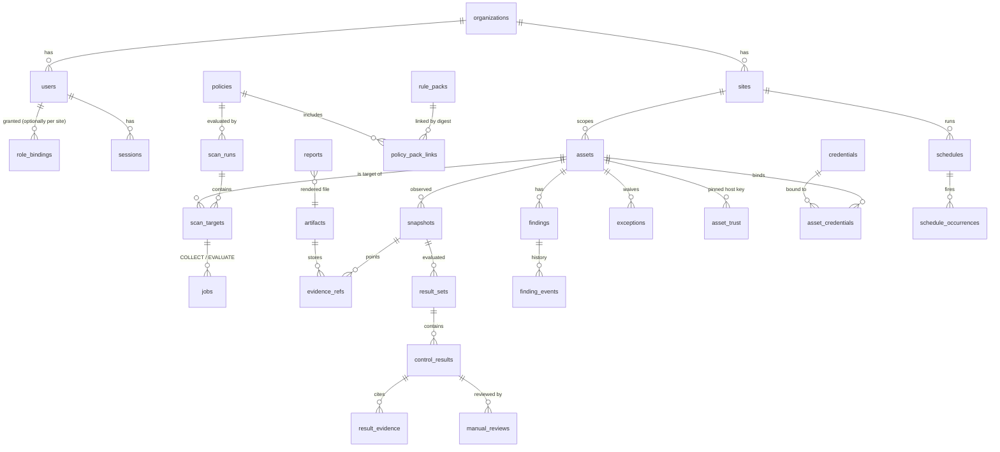

# Data model

The source of truth is `packages/persistence/src/baselineguard_persistence/models.py` together with `migrations/versions/`.

Every tenant table carries `org_id`. Every such table has a `UNIQUE (org_id, id)` key, and foreign keys are composite `(org_id, x_id)`, so a row can only reference rows of the same organization. Row-level security is enabled and forced on tenant tables (see [overview](overview.md#multi-tenancy)).

## Entity relationships

## Tables

| Table | Purpose | Key columns / notes |
|---|---|---|
| `organizations` | Tenant | `slug` (unique, used at sign-in), `status` ∈ active/suspended/archived. Not RLS-scoped; `bg_api` can read only `id, slug, status`. |
| `sites` | Network allow-list for collection | `name` (unique per org), `timezone` (IANA), `scope` JSONB `{allowed_cidrs, allowed_ports, allowed_dns_suffixes}`. |
| `assets` | Registered target | `category` ∈ windows/linux/firewall/router/switch; `address`, `port` (1–65535), `adapter_id`, `declared_role`, `identity` JSONB (vendor/family/version/role), `criticality` ∈ critical/high/normal/low, `tags`, `archived_at`. Partial unique index on (org, site, address, port, adapter) while not archived. |
| `rule_packs` | Imported rule-pack manifest | `pack_key`, `version`, `digest` (semantic digest), `manifest` JSONB, `rights_metadata`, `state` ∈ draft/approved/revoked. `bg_api` has SELECT only, so packs are registered by the seed scripts with the superuser. |
| `policies` | Immutable policy revision | `name`, `revision`, `spec` JSONB (`site_ids`, `overrides`, `exclusions`), `digest`, `state` ∈ draft/published/revoked, `author_id`, `approver_id`. A published policy must have an approver, and a trigger blocks edits to it. |
| `policy_pack_links` | Policy ↔ pack | `pack_digest` is frozen at link time. Scans refuse to run if it no longer matches the pack. |
| `scan_runs` | One assessment request | `status`, `reason`, `scope_manifest` (frozen policy/pack digests and asset identities), `requester_id`, timestamps. |
| `scan_targets` | One asset in a run | `state`, `frozen_identity`, `error_code`. Unique (run, asset). |
| `jobs` | Durable work queue | `kind` ∈ `COLLECT`/`EVALUATE`; `state`; `attempt` / `max_attempts` (≤10); `available_at`; `lease_owner` / `lease_token` / `lease_expires_at`; `cancel_requested_at`; `error_code`; `payload_ref` JSONB (asset, policy, snapshot ids, source). |
| `audit_events` | Append-only hash chain | `sequence` (unique per org), `action`, `object_type`, `object_id`, `redacted_details`, `previous_hash`, `event_hash`. A trigger blocks UPDATE/DELETE. |
| `idempotency_keys` | Replay protection for create routes | PK (org, principal, route, key); stores `request_digest` and the saved response. |
| `users` | Local accounts | `subject` (username), `email`, `auth_provider`, Argon2 `password_hash`, sealed `totp_ciphertext`, `last_totp_step`, `recovery_hashes`, `disabled_at`. |
| `role_bindings` | Role grants | (`user_id`, `role`, nullable `site_id`). A null site means organization-wide. |
| `sessions` | Revocable sessions | Token hash, `mfa_verified_at`, `last_seen_at`, `expires_at`, `revoked_at`. |
| `auth_challenges` | Pending MFA challenge | Token hash, `attempts` (max 5), `expires_at` (5 min), `consumed_at`. |
| `auth_throttles` | Sign-in rate limiting | Keyed by an HMAC of the source or account; 15-minute window. |
| `artifacts` | Encrypted evidence and report files | `storage_key`, `sha256`, `media_type`, `size_bytes`, `classification`, `encrypted`, `key_version`. Immutable. |
| `snapshots` | Normalized observation of one asset | `source` ∈ live/import/replay/fixture; `identity`; `observed_start` / `observed_end`; `digest` (SHA-256 of the facts JSON); `completeness`; `provenance` (includes the facts artifact pointer). Immutable. |
| `evidence_refs` | Snapshot → artifact pointer | `reader_id`, `pointer` (line range), `redaction_version`. Immutable. |
| `result_sets` | Evaluation of one snapshot under one policy | `engine_digest`, `semantic_digest`, `summary` (counts and score), `view` ∈ primary/original_profile/tailored. Immutable. |
| `control_results` | One control outcome | `status`, `reason_code`, `expected`, `actual`, `severity`, `assessment_quality`, `trace`, `counts_toward_score`. Immutable. |
| `result_evidence` | Result → evidence ref | Join table. |
| `findings` | Stable failing-control record | Unique (asset, control_key, context_key, resource_key). Columns: `state`, `severity`, `first_seen_at` / `last_seen_at`, `last_result_id`, `owner_id`, `due_at`. |
| `finding_events` | Finding history | `kind` ∈ OPENED, STILL_FAILING, FIXED_VERIFIED, CLOSED_NO_LONGER_APPLICABLE, ASSIGNED, DUE_SET, COMMENT, EXCEPTION_LINKED, MANUAL_REVIEW. Immutable. |
| `exceptions` | Risk acceptance | (asset, control_key), `reason`, `compensating_controls`, `requested_by`, `approved_by`, `expires_at` (must be after `created_at`), `state`. |
| `manual_reviews` | Human assessment of a result | `decision` ∈ CONFIRMED_PASS/CONFIRMED_FAIL/REJECTED_ASSESSMENT, `rationale`, `expires_at`, `supersedes_id`. It never changes the engine result. Immutable. |
| `reports` | Generated report | `format` ∈ json/html/csv/pdf, `scope_manifest`, `state`, `artifact_id`, `manifest_digest`. |
| `schedules` | Cron schedule for a site | `cron` (5 fields), `timezone`, `overlap_policy` ∈ skip/reschedule (stored but not enforced by the tick), `enabled`. |
| `schedule_occurrences` | One fired occurrence | PK (org, schedule, occurrence_at) makes the tick idempotent; `status` ∈ ENQUEUED/COMPLETED/SKIPPED. Immutable. |
| `credentials` | Sealed target credential | `kind` ∈ ssh_key/ssh_password/api_token; `encrypted_secret`; `key_version`; `metadata` (username). |
| `asset_credentials` | Credential binding | `purpose` ∈ audit_collect/preflight. |
| `asset_trust` | Pinned host identity | `trust_type` ∈ ssh_host_key/tls_certificate, `fingerprint` (`SHA256:...`), `verified_by`, `verified_at`, `revoked_at`. |
| `intent_records` | Approved intent (e.g. port purpose) | `kind` ∈ port_purpose. Table only; not used by any route. |

## State machines

### Jobs (`jobs.state`)

| State | Meaning | Next |
|---|---|---|
| `QUEUED` | Waiting until `available_at` | `RUNNING` (claimed), `CANCELLED` |
| `RUNNING` | Leased by a worker (5-minute lease token) | `COMPLETED`, `RETRY_WAIT`, `DEAD_LETTER`, `CANCELLED` |
| `RETRY_WAIT` | Retryable collector error. `available_at` is set to now + `10 × 2^attempt` s. | `RUNNING` (reclaimed once `available_at` has passed). After the 3rd attempt the collector fails closed: the target gets `ERROR` results. |
| `COMPLETED` | Done. The collector then enqueues `EVALUATE`. | — |
| `DEAD_LETTER` | Unrecoverable (target, snapshot, policy or packs unresolvable; or `POST /collector/jobs/{id}/fail`) | — |
| `CANCELLED` | `POST /scans/{id}/cancel` | — |

### Scan runs and scan targets (`scan_runs.status`, `scan_targets.state`)

Allowed values: `QUEUED`, `PREFLIGHT`, `COLLECTING`, `NORMALIZING`, `EVALUATING`, `RETRY_WAIT`, `COMPLETED`, `PARTIAL`, `FAILED`, `CANCELLED`. The current code actually uses the following:

- **Target transitions:**
  - `QUEUED` → `COLLECTING` → `EVALUATING` → `COMPLETED`, or `PARTIAL` if any control is UNKNOWN/ERROR.
  - `FAILED` when the evaluator dead-letters.
  - `CANCELLED` on cancel.
- **Run status**, derived after each target finishes:
  - `COMPLETED` if all targets completed;
  - `FAILED` if all targets failed;
  - `EVALUATING` while any target is still in flight;
  - `PARTIAL` otherwise.

  A cancelled run stays `CANCELLED`. Offline imports create a run directly in `EVALUATING`.

### Findings (`findings.state`)

| From | Event | To |
|---|---|---|
| — | Control result `FAIL` | `OPEN` (`OPENED` event) |
| `OPEN` | Exception approved, or still failing while an approved, unexpired exception exists | `RISK_ACCEPTED` |
| `OPEN` / `RISK_ACCEPTED` | Later result is not `FAIL` | `RESOLVED` (`FIXED_VERIFIED` when PASS) |
| `RESOLVED` | `FAIL` again | `OPEN` (reopened; `first_seen_at` reset) |
| `RISK_ACCEPTED` | Exception revoked | `OPEN` |

### Exceptions (`exceptions.state`)

| From | Action | To | Who |
|---|---|---|---|
| — | `POST /exceptions` (needs an existing finding for the asset and control) | `REQUESTED` | analyst, scan_operator, platform_admin |
| `REQUESTED` | approve | `APPROVED` | `risk_approver`, not the requester |
| `REQUESTED` | reject | `REJECTED` | `risk_approver`, not the requester |
| `APPROVED` | revoke | `REVOKED` | risk_approver or platform_admin |

`EXPIRED` is not stored. The API reports an `APPROVED` exception past `expires_at` with effective state `EXPIRED`.

### Other enumerations

- Rule packs: `draft` / `approved` / `revoked`. Policies: `draft` / `published` / `revoked`.
- Control result status: `PASS`, `FAIL`, `NOT_APPLICABLE`, `UNKNOWN`, `ERROR`, `MANUAL_REQUIRED`.
- Reports: `QUEUED` / `RENDERING` / `COMPLETED` / `FAILED`. The API renders synchronously and writes `COMPLETED`.
- Schedule occurrences: `ENQUEUED` / `COMPLETED` / `SKIPPED`. `SKIPPED` means the site had no non-fixture assets.

## Migrations

| Revision | Adds |
|---|---|
| `0001_phase1_core` | organizations, sites, assets, rule_packs, policies, policy_pack_links, scan_runs, scan_targets, jobs, audit_events, idempotency_keys. Forced RLS policies, the published-policy immutability trigger, the append-only audit trigger, and `bg_api` grants (applied only if the role exists). |
| `0002_job_cancellation` | `jobs.cancel_requested_at` |
| `0003_local_identity` | users, role_bindings, sessions, auth_challenges, auth_throttles, with RLS and grants |
| `0004_pipeline` | artifacts, snapshots, evidence_refs, result_sets, control_results, result_evidence, findings, finding_events, exceptions, manual_reviews, reports, schedules, schedule_occurrences, credentials, asset_credentials, asset_trust, intent_records. RLS, immutability triggers and grants. |
| `0005_exception_workflow` | `GRANT UPDATE ON exceptions TO bg_api` |
| `0006_live_onboarding_grants` | `GRANT UPDATE ON asset_trust`, `GRANT INSERT ON credentials` to `bg_api` |

Run migrations with `alembic upgrade head`. It uses `BG_MIGRATION_DATABASE_URL`. CI also rehearses `alembic downgrade base` followed by `upgrade head`.
