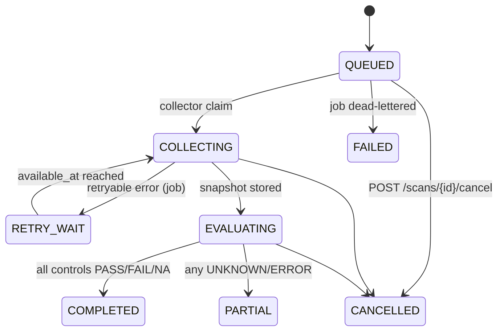

# Architecture overview

Bastion (internal package name `baselineguard`) is a deterministic configuration-compliance auditor. It collects facts from targets using fixed, read-only commands and turns them into typed facts. It then evaluates those facts against a published policy (a set of rule packs) and records immutable results, findings, exceptions and reports. No AI/ML takes part in evaluation.

Related: [data model](data-model.md) · [repository map](repository-map.md) · [threat model](threat-model.md) · [HTTP API](../api/current-api.md) · [adapters](../adapters/compatibility.md)

## Components

| Component | Code | Role |
|---|---|---|
| Web console | `apps/web` (React 19, Vite, TanStack Query) | Landing page (`/landing`), docs page (`/docs`), sign-in (`/login`) and the console: Overview, Assets, Assessments, Findings, Exceptions, Schedules, Reports, Policies. In development, Vite proxies `/api` and `/health` to `BG_API_URL` (default `http://127.0.0.1:8000`). |
| API | `apps/api` (FastAPI) | Auth/sessions, inventory, live onboarding, scans, offline imports, findings, exceptions, reports, policies, schedules. Entry point: `python -m baselineguard_api` (uvicorn on `BG_API_HOST:BG_API_PORT`). |
| Collector worker | `apps/collector` | Claims `COLLECT` jobs, runs the adapter reader, normalizes the output, stores an encrypted snapshot and enqueues `EVALUATE`. |
| Evaluator worker | `apps/evaluator` | Claims `EVALUATE` jobs, evaluates the snapshot against the policy's rule packs, and writes result sets, control results and findings in one transaction. |
| Schedule tick | `apps/api/.../scheduling.py` + `apps/scheduler` (cron math, queue primitives) | Turns due cron occurrences into scan runs, once per occurrence. |
| Reporter | `apps/reporter` | Renders JSON/HTML/CSV and a dependency-free PDF. The API calls it synchronously from `POST /api/v1/reports`. |
| Adapters | `packages/adapters` | Fixed reader command tables (Linux SSH, Cisco IOS XE, FortiGate, Windows local), the site-scope resolver, strict SSH client and normalizers. |
| Rule engine | `packages/rule_engine` | Pack loading/validation, canonical JSON and semantic digests, policy resolution, and three-valued expression evaluation. |
| Evidence store | `packages/evidence` | Content-addressed artifact files under `BG_EVIDENCE_ROOT`, AES-256-GCM envelope-encrypted with the local master key. |
| Credentials | `packages/credentials` | Seals and unseals target credentials with the master key. |
| Persistence | `packages/persistence` | SQLAlchemy models and the tenant-scoped session helper. |
| Database | PostgreSQL 17 (`deploy/compose`) | All tenant tables have forced row-level security. Alembic migrations live in `migrations/`. |

### Embedded workers (`BG_EMBEDDED_WORKERS`)

The collector and evaluator have no standalone entry point. They run inside the API process when `BG_EMBEDDED_WORKERS=true` (`apps/api/src/baselineguard_api/embedded.py`). On startup the API:

1. Creates the master key file (`BG_MASTER_KEY_FILE`) if it is missing.
2. Starts three daemon threads:
   - **scheduler**: calls `run_due_schedules`, then sleeps 30 s.
   - **evaluator**: calls `EvaluationWorker.run_one`.
   - **collector**: calls `CollectorWorker.run_one`.
   The evaluator and collector threads sleep 1 s when there is no work.
3. Logs `embedded collector and evaluator workers started`.

The workers claim jobs **across organizations**, so they connect with `BG_WORKER_DATABASE_URL` (falling back to `BG_DATABASE_URL`). The restricted `bg_api` role has no `app.org_id` set in worker transactions, so row-level security hides every job from it. A worker on that role finds no work and scans stay `QUEUED`. `.env.example` therefore ships `BG_EMBEDDED_WORKERS=true` and a `BG_WORKER_DATABASE_URL` for the `postgres` superuser. `tools/seed_demo.py` appends both to `.env` if they are missing. This is a development-only shortcut.

Loopback targets are allowed only when `BG_LAB_TARGETS=true` and `BG_ENVIRONMENT` is not `production`.

## End-to-end scan flow

```mermaid
sequenceDiagram
  autonumber
  participant UI as Web console
  participant API as FastAPI
  participant DB as PostgreSQL (RLS)
  participant C as Collector worker
  participant T as Target
  participant FS as Evidence store
  participant E as Evaluator worker
  UI->>API: POST /api/v1/scans {asset_ids, policy_revision_id}
  API->>DB: ScanRun(QUEUED) + ScanTarget(QUEUED) + Job(COLLECT, QUEUED) per asset
  C->>DB: claim COLLECT job (FOR UPDATE SKIP LOCKED), lease 5 min
  C->>C: resolve_authorized_endpoint (site scope check)
  C->>T: fixed read-only commands (strict known_hosts)
  T-->>C: raw output
  C->>C: redact + normalize to typed facts
  C->>FS: encrypted raw + facts artifacts
  C->>DB: Snapshot(digest = SHA-256 of facts JSON), Job(EVALUATE)
  E->>DB: claim EVALUATE job
  E->>FS: read facts artifact
  E->>E: evaluate every control of every linked rule pack
  E->>DB: ResultSet + ControlResults + Findings (one transaction), run status
  UI->>API: GET /overview, /findings, /assessments; POST /reports
```

Step by step:

1. **Asset.** `POST /api/v1/assets` checks that the address and port fall inside the site's `scope`, then stores the asset. The asset's `adapter_id` decides how it is collected: `live_ssh` (`linux-ssh`, `cisco-iosxe`, `fortigate-ssh`), `live_local` (`windows-local`), `fixture` (`*-fixture`) or `import` (anything else).
2. **Onboarding (live SSH only).** `POST /assets/{id}/host-key` reads the device's SSH host-key fingerprint. `POST /assets/{id}/connect` re-reads it, refuses if it changed, then:
   - pins the key in `BG_KNOWN_HOSTS_FILE`;
   - records an `asset_trust` row;
   - seals the credential and binds it with purpose `audit_collect`.
   See [adapters](../adapters/compatibility.md#host-key-pinning-flow).
3. **Scan request.** `POST /api/v1/scans` requires:
   - the `scan_operator` role;
   - a published policy whose linked packs are `approved` and still match their digest;
   - assets inside the caller's sites and inside the policy's `site_ids` (if any).

   It freezes a `scope_manifest` (policy digest, pack digests, asset identities) and enqueues one `COLLECT` job per target.
4. **Collector job queue and leases.** The collector selects the oldest `QUEUED` `COLLECT` job without a cancel request (`FOR UPDATE SKIP LOCKED`). It marks the job `RUNNING` with a fresh lease token and a 5-minute lease.
   - **Retryable failures:** the job goes to `RETRY_WAIT` with backoff `10 × 2^attempt` seconds (20 s, then 40 s). The collector reclaims `RETRY_WAIT` jobs once `available_at` has passed. On the third failed attempt (`max_attempts` = 3) the job fails closed, as below. Only Linux SSH errors other than auth/host-key errors are retryable.
   - **Other failures:** "fail closed". An empty snapshot carrying the error code is stored, so every applicable control evaluates to `ERROR` and the run still completes.
   - **Fencing:** completion is applied only if the lease token still matches and no cancel was requested.
5. **Site scope check.** `resolve_authorized_endpoint`:
   - checks the port against `allowed_ports`;
   - checks a hostname against `allowed_dns_suffixes`, then resolves it once;
   - rejects loopback, link-local, multicast, reserved and other non-private, non-global addresses (loopback is allowed when `BG_LAB_TARGETS`);
   - requires every resolved address to be inside `allowed_cidrs`.

   The socket then connects to the pinned IP, which prevents DNS rebinding. `windows-local` and fixture adapters skip this step.
6. **Adapter reader.** The reader depends on the adapter:
   - **Live SSH** (paramiko `RejectPolicy`, no agent or key lookup): fixed command tables for Linux, Cisco IOS XE and FortiGate.
   - **`windows-local`:** runs fixed PowerShell/`auditpol` commands **on the machine where the collector runs**.
   - **`*-fixture`:** reads a declared raw-output file from a configured fixture root.
   - **Offline import:** skips the collector entirely. `POST /api/v1/imports` stores already-normalized facts as a snapshot with `source='import'` and enqueues `EVALUATE` directly.
7. **Normalizer.** `baselineguard_adapters.orchestrate.normalize_outputs` turns reader outputs into `NormalizedFact` records. Each record has a state (`PRESENT`, or a non-present state), a typed value and an evidence pointer (reader id, source SHA-256, line range, redaction version). Cisco secrets are redacted before persistence.
8. **Snapshot.** `persist_snapshot` stores redacted raw output and the facts JSON as encrypted artifacts. It writes an immutable `snapshots` row whose `digest` is the SHA-256 of the facts JSON, plus `completeness` (`COMPLETE`, `PARTIAL`, or `INCOMPLETE` with an `error_code`).
9. **Evaluator.** The evaluator loads the facts and every rule pack linked to the policy, and resolves overrides and exclusions from the policy spec. It evaluates each control's `applicability` and assertion with three-valued logic:
   - Controls for another platform are `NOT_APPLICABLE`. Applicability is decided by facts such as `platform.family`; the pack's `version_range` is metadata only.
   - Missing facts give `UNKNOWN`.
   - A collection error gives `ERROR`.

   An `engine_digest` binds the engine version, pack digests, policy digest and snapshot digest. `persist.finalize` writes the result set, control results and finding updates, and sets the target to `COMPLETED` or `PARTIAL` (when any control is UNKNOWN or ERROR). It also derives the run status.
10. **Findings and exceptions.**
    - A `FAIL` opens a finding (or keeps it open).
    - A later non-`FAIL` resolves an `OPEN` or `RISK_ACCEPTED` finding.
    - An approved, unexpired exception for the same asset and control turns an open finding into `RISK_ACCEPTED`.
11. **Reports.** `POST /api/v1/reports` renders the latest result set per visible asset as `json`, `html`, `csv` or `pdf`. The file is stored as an encrypted artifact. Every download is written to the audit log.



(Scan-target states. A run is `COMPLETED` if all its targets completed, `FAILED` if all failed, `EVALUATING` while any is in flight, and `PARTIAL` otherwise.)

## Multi-tenancy

- Every tenant table carries `org_id`. Composite `(org_id, id)` keys and composite foreign keys stop cross-organization references.
- Migrations enable **and force** row-level security on every tenant table. Each table gets the policy `org_id = nullif(current_setting('app.org_id', true), '')::uuid`.
- Each authenticated request opens a transaction that sets `app.org_id` transaction-locally (`set_config(..., true)`). The helper is `baselineguard_persistence.database.scoped_session`, used through `get_org_db`. The client never chooses the organization: it comes from the session cookie.
- The API connects as `bg_api` (`NOBYPASSRLS`, not the table owner). Migrations run as `bg_migration`, the schema owner. Both roles are created by `deploy/compose/init/001-runtime-roles.sh`.
- On top of RLS, routes apply role checks and site checks (`Principal.sites_for`). A role binding with no `site_id` is organization-wide.

## Authentication

| Mechanism | Details |
|---|---|
| Password | Argon2 (`argon2-cffi`). `POST /auth/login` returns a 5-minute MFA challenge. Rate-limited per source IP (100) and per account (20) per 15-minute window. |
| TOTP MFA | 6-digit TOTP, or one of the one-time recovery codes. The TOTP secret is sealed with the master key and bound to `org/user/totp`. A used time step cannot be replayed (`last_totp_step`). |
| Session | Cookie `__Host-bg_session` (HttpOnly, Secure, SameSite=Lax, 12 h absolute, 30 min idle). Only a hash of the token is stored. |
| CSRF | Every non-GET request needs `X-CSRF-Token` = HMAC(`BG_SESSION_SECRET`, session token). The value is returned by `/auth/mfa/verify`, `/auth/demo-login` and `GET /api/v1/me`. |
| Recent MFA | Policy publication requires an MFA verification within the last 5 minutes. |
| Demo login | When `BG_DEMO_LOGIN=true` (rejected when `BG_ENVIRONMENT=production`), `/auth/demo-login` signs in with password only and `/auth/demo-code` returns the current TOTP code for a pending challenge. The audit event records `factor: demo-password-only`. Note: a demo session still stamps `mfa_verified_at`, so it satisfies the recent-MFA check. |
| Bootstrap | `python -m baselineguard_api.bootstrap --organization ... --name ... --username ... --email ... --roles ...` prompts for a password and TOTP code and prints recovery codes. |

Roles used by the code: `platform_admin`, `inventory_editor`, `scan_operator`, `analyst`, `auditor`, `viewer`, `policy_author`, `policy_approver`, `risk_approver`, `manual_assessor`, `credential_admin`.

## Audit hash chain

`append_audit_event` (`apps/api/src/baselineguard_api/audit.py`) writes one `audit_events` row per security-relevant action. Actions include sign-in and sign-out, site/asset creation, bulk import and archive, live connect, scan creation, snapshot import, finding updates, manual review, exceptions, report download, policy publish and schedule changes. For each event it:

- takes a per-organization advisory lock;
- assigns the next `sequence`;
- computes `event_hash = SHA-256(canonical_json({id, org_id, sequence, actor_id, action, object_type, object_id, redacted_details, previous_hash, occurred_at}))`, chaining to the previous event (the first event uses 64 zeros).

A trigger rejects `UPDATE` and `DELETE` on `audit_events`. Snapshots, artifacts, evidence refs, result sets, control results, finding events, manual reviews and schedule occurrences are also immutable via triggers. There is currently **no API or tool that verifies the chain**. Verification would have to recompute the hashes in SQL or Python.

## Architecture decisions

- [ADR-0001: Modular monolith with separate worker processes](adr/0001-modular-monolith.md)
- [ADR-0002: PostgreSQL tenant context and row-level security](adr/0002-postgres-tenancy-and-rls.md)
- [ADR-0003: Phase 0 external gates remain open](adr/0003-phase0-external-gates.md)
