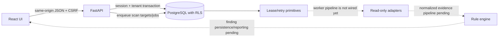

# Repository map and runtime boundaries

The workspace follows the modular monolith and PostgreSQL tenancy decisions in [`PRD.md`](../../PRD.md), ADR 0001, and ADR 0002. Python applications are separate package boundaries, but this is not yet a complete multi-process deployment.

| Path | Responsibility | Current state |
|---|---|---|
| `apps/api` | FastAPI auth, inventory, policy and scan request routes | Runs as an API; scan requests enqueue work but are not processed end to end |
| `apps/collector` | Future isolated worker boundary | Package only; no production worker entry point |
| `apps/evaluator` | Future deterministic assessment pipeline | Package only; rule engine exists separately |
| `apps/reporter` | Frozen report model and offline JSON/HTML/CSV renderers | Tested renderer library; no PDF renderer, report job/API integration or worker process |
| `apps/scheduler` | Queue lease, retry and fencing primitives | Library functions and tests; no durable schedule service |
| `packages/adapters` | Bounded, read-only transport and vendor reader code | Linux SSH and IOS XE readers; live compatibility gates remain open |
| `packages/contracts` | Pydantic API and domain contracts | Versioned request/result contracts; not every PRD workflow is represented |
| `packages/domain` | Deterministic scoring and network ACL analysis | Pure domain functions with fixtures; not yet wired into a completed scan pipeline |
| `packages/rule_engine` | Rule-pack validation, canonicalization and deterministic evaluation | Implemented for the current declarative schema and tested fixtures |
| `packages/persistence` | SQLAlchemy models, tenant-aware sessions, PostgreSQL persistence | Initial schema and identity/queue migrations; finding/evidence/schedule schemas remain incomplete |
| `content` | Rule schema, original rule packs, compatibility declarations | Only original demo rules; no CIS-derived content is included |
| `migrations` | PostgreSQL schema and security policy changes | Alembic revisions through local identity and cancellation |
| `apps/web` | React/TypeScript GUI | Sign-in, overview, inventory and assessment request views; several navigation destinations are not implemented |
| `tests` | Unit, integration and browser checks | Fixture-focused; PostgreSQL tests skip unless DB URLs are provisioned; E2E uses synthetic APIs |
| `deploy` | Development Compose database | Not a production deployment; production packaging is explicitly deferred |

## Current request path

Production responsibilities for workers, credential vault, evidence storage, schedule execution, backups, HA, observability and deployment must be completed and tested before release claims.
