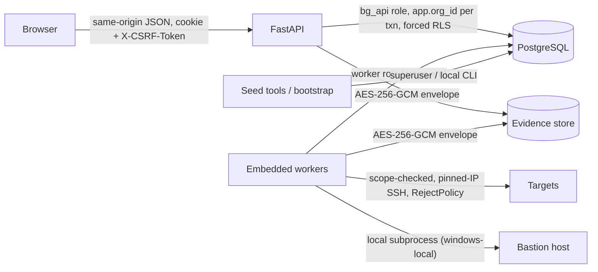

# Threat model

This page lists the assets Bastion protects, its trust boundaries, and the controls that exist in the current code. It is an engineering record, not a substitute for an independent security review, which has not been done.

## Assets

- Target credentials: sealed in `credentials.encrypted_secret`.
- The local master key: `BG_MASTER_KEY_FILE`.
- The session secret: `BG_SESSION_SECRET`.
- Pinned host keys: `BG_KNOWN_HOSTS_FILE`.
- Raw and normalized evidence: encrypted artifacts under `BG_EVIDENCE_ROOT`.
- Results, findings and exceptions.
- Rule packs and policies.
- The per-organization audit chain.

## Trust boundaries

## Threats and controls

| Threat | Controls in code | Gaps |
|---|---|---|
| Cross-tenant read/write | `org_id` on every tenant row; composite FKs; forced RLS keyed on transaction-local `app.org_id`; the API runtime role is `NOBYPASSRLS` and not the owner; site filters via `Principal.sites_for` | Workers and seed tools use a cross-org role (the dev superuser). `GET /assessments` is not site-filtered. |
| SSRF / scanning outside authorization | Site `allowed_cidrs`/`allowed_ports`/`allowed_dns_suffixes`. Every resolved address is authorized. Loopback, link-local, multicast, reserved and CGNAT addresses are refused (loopback only with `BG_LAB_TARGETS` outside production). The socket connects to the pinned IP (no re-resolution). `/0` CIDRs are rejected. | CSV import commit does not re-check CIDR scope (collection still does) |
| DNS rebinding | Resolve once, authorize all answers, connect to a pinned IP | — |
| SSH man-in-the-middle | The fingerprint is shown before credentials are sent; it is re-read and compared at connect (`HOST_KEY_CHANGED`); the collector uses paramiko `RejectPolicy` with only the pinned file; a trust record is required (`TRUST_NOT_VERIFIED`) | Trust-on-first-use relies on a human comparing the fingerprint |
| Command injection on targets | Fixed command tables; reader ids validated against an allow-list; no caller-supplied command text; Linux runs `exec` without a PTY | `windows-local` uses `shell=True` with constant strings only |
| Target modification | Read-only commands only. Cisco sends only the session-local `terminal length/width`. Ubuntu needs only a sudoers rule for `/usr/sbin/sshd -T`. Remediation text is never executed. | `secedit /export` writes and deletes a temp file on the Windows host |
| Hostile device output | 1 MiB output cap, reader timeouts, strict UTF-8 (Linux), parser line bounds, pagination/error detection (Cisco), facts typed via Pydantic | — |
| Secret leakage in evidence | Cisco secret-line redaction before persistence; credentials sealed with org- and id-bound AAD; passwords never logged; report HTML/CSV escaping and formula protection | Redaction coverage for FortiGate/Linux output is limited to what the readers return |
| Credential theft from the database | Credentials and TOTP secrets are AES-GCM sealed with the master key; `bg_api` cannot read `organizations` beyond id/slug/status | The master key is a local file. Anyone with filesystem access to `data/keys` can decrypt. |
| Account takeover | Argon2 passwords; TOTP with replay protection; recovery codes; throttling (100/source, 20/account per 15 min); 5 attempts per challenge; sessions hashed, revocable, 12 h absolute / 30 min idle; `__Host-` Secure HttpOnly SameSite=Lax cookie | `BG_DEMO_LOGIN` bypasses MFA (blocked in production, audited) |
| CSRF / clickjacking | HMAC CSRF token required on writes; `X-Frame-Options: DENY`; CSP on preview/production builds; CORS off by default and forbidden in production | — |
| Tampering with history | Append-only triggers on `audit_events`, snapshots, artifacts, result sets, control results, finding events, manual reviews, schedule occurrences; published policies immutable; SHA-256 snapshot/engine/semantic digests; per-org audit hash chain | No chain verifier is shipped; a database superuser can still drop triggers |
| Unsafe rule content | Safe YAML loader with duplicate-key rejection, size/depth/node bounds, JSON Schema validation, declarative expressions only; pack digest frozen into policies | Packs are registered by the superuser seed tools (no review workflow) |
| Self-approval / insider risk | The policy author cannot publish their own draft; exception requesters cannot approve or reject their own exceptions; publication needs MFA within 5 minutes | Demo sessions count as MFA-verified |
| Missing evidence reported as compliant | Explicit `UNKNOWN`/`ERROR`/`NOT_APPLICABLE`; a collection failure yields `ERROR`, never PASS; completeness is shown next to compliance | — |
| Unauthorized job manipulation | Lease tokens fence worker completion; cancellation sets `cancel_requested_at`; the collector routes require scan_operator or platform_admin | Embedded workers do not recover expired leases |

## Operating assumptions

- Run only against systems you are authorized to audit, with dedicated read-only accounts.
- Never enable `BG_DEMO_LOGIN` or `BG_LAB_TARGETS` outside a demo or lab. The settings validator refuses both in `production`.
- Keep `.env`, `data/keys/`, `data/demo-credentials.json` and `data/known_hosts` out of Git. `.gitignore` excludes `.env*` and `data/`.
- Give the worker a dedicated, minimally privileged cross-org role in any shared deployment, not the PostgreSQL superuser.
